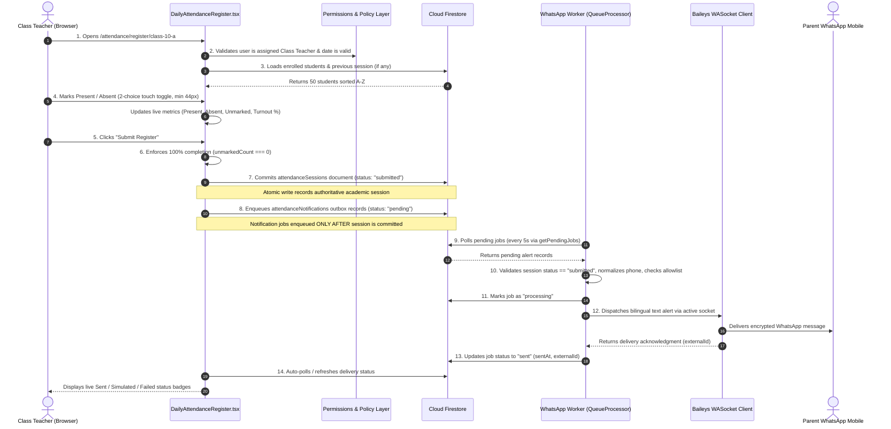

# HanuJai High School ERP — Complete Institutional System Reference Manual

**Document Name:** `Hanujai-ERP-completeinfo.md`  
**Campus:** HanuJai High School, Sector 3, Vidyadhar Nagar, Jaipur, Rajasthan 302039, India  
**Affiliation:** Central Board of Secondary Education (CBSE), Affiliation #1730249, School Code 30198  
**Repository Location:** `C:\Projects\School\hanujai-erp`  
**Original Gibbon Core (Untouched Reference):** `C:\Projects\School\core`  
**Current Production Milestone:** Phase 1 (Student Master Roster, Daily Morning Attendance, Parent WhatsApp Notifications)  
**System Status:** Fully Integrated, Statically Type-Checked (`tsc --noEmit` clean), Production-Ready Architecture  

---

## Master Table of Contents

1. [Executive Overview & Institutional Identity](#1-executive-overview--institutional-identity)
2. [Complete System Architecture & Deployment Topology](#2-complete-system-architecture--deployment-topology)
3. [Authentication, Authorization & Role-Based Access Control (RBAC)](#3-authentication-authorization--role-based-access-control-rbac)
4. [Complete Institutional Business Rules & Operational Policies](#4-complete-institutional-business-rules--operational-policies)
5. [Exhaustive Data Storage Dictionary (Where & How Everything Is Stored)](#5-exhaustive-data-storage-dictionary-where--how-everything-is-stored)
6. [Daily Attendance Workflow & WhatsApp Messaging Architecture](#6-daily-attendance-workflow--whatsapp-messaging-architecture)
7. [UI/UX Design System, Institutional Color Tokens & Accessibility](#7-uiux-design-system-institutional-color-tokens--accessibility)
8. [Institutional Reporting, Printable Slips & Excel Exporting](#8-institutional-reporting-printable-slips--excel-exporting)
9. [Environment Configuration & Variables Reference](#9-environment-configuration--variables-reference)
10. [Complete Repository Directory Tree & File Inventory](#10-complete-repository-directory-tree--file-inventory)
11. [Developer Operations, Runbook & Safe Maintenance Guidelines](#11-developer-operations-runbook--safe-maintenance-guidelines)

---

## 1. Executive Overview & Institutional Identity

### 1.1 Institutional Profile
* **School Name:** HanuJai High School, Jaipur
* **Campus Address:** Sector 3, Vidyadhar Nagar, Jaipur, Rajasthan 302039, India
* **Founding Year:** 1998
* **Institutional Motto:** *Vidya Dadati Vinayam* (Knowledge Imparts Discipline & Humility)
* **Administrative Leadership:** Dr. Vikramaditya Sharma, Principal & Head of School (`staff-001`)
* **Board Affiliation:** Central Board of Secondary Education (CBSE), Affiliation No. `1730249`, School Code `30198`

### 1.2 System Scale & Demographic Scope
The ERP is architected around a strict, deterministic single-school institutional model:
* **Academic Range:** Classes 1 to 10 (Grades 1 through 10).
* **Section Breakdown:** Exactly 2 sections per grade (`A` and `B`), yielding **20 total academic class sections** (`class-01-a` through `class-10-b`).
* **Section Enrollment Capacity:** Exactly 50 enrolled students per section.
* **School Population:** Exactly **1,000 total enrolled students** across the campus.
* **Faculty Staffing:** 22+ active staff accounts, including Executive Leadership (Principal), dedicated Section Class Teachers, and Subject Faculty.

### 1.3 Phase-Locked Feature Scoping
The platform is organized into phased operational milestones managed by `src/config/phase.ts`:
* **Phase 1 (Active Production Milestone):**
  1. *Student Directory & Master Dossiers:* Profile lookup, guardian phone numbers, care flags.
  2. *Class Teacher Daily Attendance:* Fast, mobile-first morning roll-call register with 2-choice toggles (Present / Absent) and live percentage counters.
  3. *Parent WhatsApp Attendance Alerts:* Automated, asynchronous bilingual notifications (English & Hindi) dispatched via a persistent server-side worker daemon.
* **Phase 2 & Phase 3 (Preserved in Codebase, Hidden from Active Phase 1 UI):**
  - Continuous Assessment Cycles (Unit Tests 1 & 2, Half-Yearly, Annual Examinations).
  - Subject Teacher Marks Entry Registers with CBSE 9-point grading calculations.
  - Pastoral Care & Student Disciplinary Behaviour Dossiers.
  - Historical 3-Year Academic & Attendance Trend Progression.
  - Dual-Custody Attendance Correction Workflows with administrative approval gates.

---

## 2. Complete System Architecture & Deployment Topology

### 2.1 Technology Stack Matrix
* **Frontend Framework:** React 18 (`react: ^18.3.1`, `react-dom: ^18.3.1`)
* **Language & Compiler:** TypeScript 5.6 (`typescript: ^5.6.3`) in strict mode
* **Build Tooling & Bundler:** Vite 5.4 (`vite: ^5.4.11`) with `@vitejs/plugin-react: ^4.3.3`
* **Client-Side Routing:** React Router v6 (`react-router-dom: ^6.28.0`)
* **Cloud Database & Auth:** Google Firebase SDK v11 (`firebase: ^11.0.2`), specifically **Cloud Firestore** and **Firebase Authentication**
* **Icons & Visual Indicators:** Lucide React (`lucide-react: ^0.460.0`)
* **Data Visualization & Charts:** Recharts (`recharts: ^3.10.1`)
* **Binary Spreadsheets:** SheetJS (`xlsx: ^0.18.5`)
* **WhatsApp Automation Engine:** `@whiskeysockets/baileys: ^7.0.0-rc14`
* **Worker Logging & QR:** Pino (`pino: ^9.5.0`), QR Terminal (`qrcode-terminal: ^0.12.0`), Canvas QR (`qrcode: ^1.5.4`)

### 2.2 Dual-Mode Data Abstraction Layer
The application implements an abstract repository pattern through `DataProvider` (`src/data/provider.ts`), completely decoupling UI components from backend storage mechanics:
```
               ┌────────────────────────────────────────────────────────┐
               │              React Application Views / Pages           │
               └───────────────────────────┬────────────────────────────┘
                                           │
                                           ▼
               ┌────────────────────────────────────────────────────────┐
               │         DataProvider Interface (src/data/provider.ts)  │
               └─────────────┬────────────────────────────┬─────────────┘
                             │                            │
             (VITE_DATA_MODE=firebase)            (VITE_DATA_MODE=demo)
                             │                            │
                             ▼                            ▼
              ┌──────────────────────────────┐ ┌─────────────────────────┐
              │ FirestoreRepository          │ │ DemoRepository          │
              │ (Cloud Firestore Live DB)    │ │ (In-Memory + LocalStore)│
              └──────────────────────────────┘ └─────────────────────────┘
```
1. **Cloud Mode (`VITE_DATA_MODE=firebase`):**
   - Reads and writes directly to Cloud Firestore.
   - Enforces Firestore security rules, live transactions, and atomic batch writes.
   - Requires valid Firebase project credentials in `.env.local`.
2. **Demo Mode (`VITE_DATA_MODE=demo`):**
   - Zero external cloud dependencies; runs completely offline in the browser.
   - Seeded with deterministic baseline fixtures (1,000 students, 20 sections, historical sessions).
   - Mutations persist in the user's browser `localStorage` (`hanujai_demo_*`).

### 2.3 System Topology Diagram

```mermaid
graph TB
    subgraph ClientBrowser [Browser Client - Desktop & Mobile]
        TeacherUI[Class Teacher / Principal UI]
        AuthCtx[Auth Context & Session]
        DataCtx[DataProvider Abstraction Layer]
    end

    subgraph VercelCloud [Vercel Hosting Platform]
        StaticDist[Vite SPA Static Distribution dist/]
        SPARoutes[Single Page Rewrites /(.*) -> /index.html]
    end

    subgraph FirebaseCloud [Google Firebase Cloud Infrastructure]
        FirebaseAuth[Firebase Authentication Service]
        Firestore[(Cloud Firestore NoSQL)]
        subgraph Collections [Firestore Database Collections]
            ColStaff[staff]
            ColStudents[students]
            ColSessions[attendanceSessions]
            ColQueue[attendanceNotifications]
            ColMarks[marksRegisters]
            ColAudit[auditEvents]
        end
    end

    subgraph PersistentWorkerHost [Persistent Worker Host (Railway / Render / VPS)]
        WorkerDaemon[Node.js Background Process whatsapp-worker/]
        BaileysSock[Baileys WASocket Client Engine]
        QueueProc[Queue Processor Interval 5s]
        AuthDisk[Persistent Disk Volume .baileys_auth/]
        HttpHealth[Local HTTP Health Port 5050]
    end

    subgraph MetaNetwork [WhatsApp / Meta Infrastructure]
        MetaWS[WhatsApp Web WebSocket wss://web.whatsapp.com]
        ParentPhone[Parent / Guardian Phone]
    end

    %% Flow lines
    TeacherUI -->|1. Loads SPA Bundle| StaticDist
    StaticDist --> SPARoutes
    TeacherUI -->|2. Authenticates| FirebaseAuth
    TeacherUI -->|3. Queries / Submits Data| Firestore
    TeacherUI -->|4. Writes Daily Register| ColSessions
    TeacherUI -->|5. Enqueues Outbox Alert| ColQueue

    QueueProc -->|6. Polls Pending Jobs (every 5s)| ColQueue
    QueueProc -->|7. Validates & Normalizes Number| Firestore
    QueueProc -->|8. Sends Alert via Active Socket| BaileysSock
    BaileysSock -->|9. Outgoing TLS Encrypted Socket| MetaWS
    MetaWS -->|10. Delivers WhatsApp Alert| ParentPhone

    BaileysSock <-->|Persistent Keys & Creds| AuthDisk
    QueueProc -->|11. Writes Outcome sent/failed/skipped| ColQueue
    TeacherUI -.->|12. Displays Live Delivery Badges| ColQueue
    WorkerDaemon --- HttpHealth
```

---

## 3. Authentication, Authorization & Role-Based Access Control (RBAC)

### 3.1 Authentication Workflow
1. **Credentials:** Staff sign in with institutional email (`@hanujai.edu.in`) and password via `src/pages/auth/StaffLogin.tsx`.
2. **Provider:** Handled through Firebase Authentication (`signInWithEmailAndPassword`) in Cloud Mode, or local identity resolution in Demo Mode.
3. **Session Hydration:** Upon sign-in, `AuthContext.tsx` reads `/staff/{uid}` from Cloud Firestore to extract the user's role, designation, employee code, assigned class, and subject mappings.

### 3.2 The Three Institutional Roles

```
                              ┌───────────────────────────┐
                              │         PRINCIPAL         │
                              │  (Institutional Oversight)│
                              └─────────────┬─────────────┘
                                            │
                    ┌───────────────────────┴───────────────────────┐
                    │                                               │
                    ▼                                               ▼
      ┌───────────────────────────┐                   ┌───────────────────────────┐
      │       CLASS TEACHER       │                   │      SUBJECT TEACHER      │
      │  (Assigned Section Tutor) │                   │ (Specialist Class Faculty)│
      └───────────────────────────┘                   └───────────────────────────┘
```

#### 1. Principal (`role: 'principal'`)
* **Operational Scope:** School-wide institutional oversight across all 20 class sections and all academic disciplines.
* **Permissions:**
  - View school-wide attendance metrics, dashboards, and daily turnout rates.
  - Access student master directories, dossiers, confidential care flags, and report cards.
  - Access the immutable system security audit ledger (`auditEvents`).
  - Configure school settings, academic sessions, and CBSE affiliation parameters.
* **Strict Prohibitions:**
  - **Cannot mark daily attendance.** Daily roll call is the exclusive operational duty of the section's Class Teacher.
  - **Cannot directly enter or overwrite subject marks.** Marks entry belongs to the assigned Subject Teacher.
  - **Cannot create self-approved attendance corrections (Rule SEC-201).**

#### 2. Class Teacher (`role: 'class_teacher'`)
* **Operational Scope:** Assigned to exactly one primary class/section (e.g. Shri Alok Saxena assigned to `class-10-a`).
* **Permissions:**
  - **Sole authority to mark morning roll-call attendance** for their designated section.
  - Trigger and monitor automated bilingual parent WhatsApp attendance notifications.
  - View individual absence lists, student dossiers, and parent contact information for their section.
  - Request dual-custody attendance corrections after the morning window closes.
  - Log pastoral observations and teacher notes for students in their section.
* **Strict Prohibitions:**
  - Cannot mark attendance for unassigned class sections.
  - Cannot enter marks for subjects they do not teach.
  - Cannot approve their own attendance correction requests.

#### 3. Subject Teacher (`role: 'subject_teacher'`)
* **Operational Scope:** Specialist faculty assigned to specific subjects across classes (e.g. Smt. Priyanka Sen teaching Science to 10-A, 10-B, 9-A, 9-B).
* **Permissions:**
  - Enter and submit periodic examination marks for assigned subject registers.
  - View section academic performance ledgers for assigned classes.
  - View aggregate section attendance counts (e.g., "48 Present, 2 Absent").
* **Strict Prohibitions:**
  - **Strictly forbidden from viewing individual student absence lists.**
  - **Strictly forbidden from marking morning roll call.**
  - Cannot view or edit marks registers for subjects they do not teach.

### 3.3 Assignment-Based Access Control (ABAC) for Dual Roles
In Indian secondary schools, teachers frequently serve as both a **Class Teacher** for one section and a **Subject Teacher** across multiple classes:
* **Example:** Shri Alok Saxena (`staff-003`):
  - `assignedClassId: 'class-10-a'` (Class Teacher of 10-A).
  - `assignedSubjects: ['sub-math-10', 'sub-math-09']` (Mathematics Teacher).
  - `assignedClasses: ['class-10-a', 'class-10-b', 'class-09-a', 'class-09-b']`.
* **Dynamic Resolution:** Handled in `src/domain/permissions.ts`:
  - In Class 10-A: Can mark daily attendance, view student dossiers, trigger WhatsApp alerts, and enter Math marks.
  - In Class 10-B, 9-A, 9-B: Can enter Math marks only; cannot mark daily attendance or access pastoral notes.

### 3.4 Cloud Firestore Security Rules Summary (`firestore.rules`)
Security is not merely enforced in client UI code; Cloud Firestore strictly enforces RBAC at the network protocol layer:
* **Helper Functions:**
  ```javascript
  function isAuthenticated() { return request.auth != null; }
  function getUserData() { return get(/databases/$(database)/documents/staff/$(request.auth.uid)).data; }
  function isPrincipal() { return isAuthenticated() && getUserData().role == 'principal'; }
  function isAssignedClassTeacher(classId) {
    return isAuthenticated() && getUserData().role == 'class_teacher' && getUserData().assignedClassId == classId;
  }
  function isAssignedSubjectTeacher(classId, subjectId) {
    return isAuthenticated() && getUserData().role == 'subject_teacher' &&
      subjectId in getUserData().assignedSubjects && classId in getUserData().assignedClasses;
  }
  ```
* **Attendance Security Rule:**
  - `allow create, update: if isAuthenticated() && isAssignedClassTeacher(request.resource.data.classId);`
  - Prevents non-class teachers and even the Principal from modifying daily roll call.
* **Audit Immutability Rule:**
  - `auditEvents` allows `create` with verified actor UID; `allow update, delete: if false;` ensures no staff member can tamper with or erase security logs.

---

## 4. Complete Institutional Business Rules & Operational Policies

### 4.1 Daily Attendance Register Rules
1. **Morning Roll-Call Window:**
   - Standard Operating Window: **07:45 AM to 09:15 AM IST** (configured in `INSTITUTIONAL_CONFIG.attendance`).
   - Grace Period: 15 minutes (until 09:30 AM IST).
   - Post-Window Policy: Once the window closes, the register locks. Any retrospective adjustments require formal dual-custody correction.
2. **Two-Choice Attendance State Rule (Phase 1):**
   - Every student is strictly evaluated as either **Present** (`'present'`) or **Absent** (`'absent'`).
   - Legacy or future states (`'late'`, `'excused'`) are disabled in Phase 1 UI.
   - Newly opened registers start in an uncommitted draft state (`state: null`).
3. **Mandatory 100% Marking Rule:**
   - A register cannot be submitted if any student remains unmarked (`unmarkedCount > 0`).
   - Clicking "Submit Register" with unmarked students blocks submission, displays a high-contrast coral alert banner, and smoothly scrolls to the first unmarked record.
4. **Ascending A–Z Roll-Call Sorting Rule:**
   - All student rosters in the attendance register are sorted in **ascending alphabetical order (A–Z)** by `firstName`, then `lastName`, with `rollNumber` as a secondary tie-breaker.
   - Matches standard Indian school conventions where roll calls proceed alphabetically from A to Z.
5. **Turnout Percentage Calculation:**
   $$\text{Turnout Rate (\%)} = \left( \frac{\text{Present Count}}{\text{Total Enrolled Students}} \right) \times 100$$
   - Displayed with fixed 1-decimal precision (e.g. `96.0%`).

### 4.2 Statutory CBSE Attendance Policies
1. **The 75.0% Attendance Rule (Rule #ATT-03):**
   - Statutory CBSE minimum cumulative attendance requirement is **75.0%**.
   - Any student whose cumulative attendance falls below 75.0% is automatically flagged with `ATT-03` (*Attendance Shortfall Below 75%*).
   - Recommended Action: Formal shortfall notice to primary guardian and mandatory Parent-Teacher Conference (PTM) scheduling.
2. **Consecutive Absence Alert (Rule #ATT-01):**
   - Triggered when a student is recorded absent on **3 consecutive operational school days** without an approved medical note.
   - Severity: Alert. Triggers immediate telephonic outreach by the Class Tutor.

### 4.3 Dual-Custody Correction Policy (Rule SEC-201)
* **Principle:** No single individual can retroactively alter an officially submitted academic or attendance legal register.
* **Workflow:**
  1. Class Teacher discovers an error (e.g., student was marked absent but arrived with school office slip).
  2. Class Teacher submits an `attendanceCorrections` request with previous state, requested state, and mandatory written justification.
  3. Principal reviews request, cross-examines campus logbook, and counter-signs approval.
  4. Status transitions from `pending_principal` to `approved` or `rejected`.
* **Anti-Collusion Rule:** Self-approval is strictly forbidden (`allowSelfApproval: false`).

### 4.4 CBSE Academic Grading Scale & Passing Thresholds
Evaluation in secondary grades strictly follows the CBSE 9-point grading scale (`INSTITUTIONAL_CONFIG.gradingScale`):

| Grade | Marks Percentage Range | Grade Point | Performance Classification |
|---|---|---|---|
| **A1** | 91.0% to 100.0% | 10.0 | Outstanding scholastic achievement |
| **A2** | 81.0% to 90.99% | 9.0 | Excellent performance |
| **B1** | 71.0% to 80.99% | 8.0 | Very Good |
| **B2** | 61.0% to 70.99% | 7.0 | Good |
| **C1** | 51.0% to 60.99% | 6.0 | Above Average |
| **C2** | 41.0% to 50.99% | 5.0 | Average |
| **D** | 33.0% to 40.99% | 4.0 | Pass / Minimum Competency |
| **E1** | 21.0% to 32.99% | 0.0 | Essential Repeat / Remedial Required |
| **E2** | 0.0% to 20.99% | 0.0 | Critical Academic Shortfall |

* **Passing Criteria:** Minimum **33.0%** in individual subjects and overall aggregate.
* **Academic Score Drop Rule (`ACAD-04`):** Performance decline exceeding **20.0%** across comparable assessment cycles in core subjects triggers a warning and remedial diagnostic assignment.

---

## 5. Exhaustive Data Storage Dictionary (Where & How Everything Is Stored)

This dictionary details every entity, schema, primary key format, storage mechanism, access boundary, and lifecycle rule across both Cloud Firestore and local storage.

### 5.1 School Settings & Institutional Metadata
* **Firestore Collection:** `schoolSettings`
* **Document ID:** `hhs-settings-jaipur`
* **Demo Storage:** `localStorage` key `hanujai_demo_settings` (fallback: `initialSettings`)
* **Writers:** System Administrators / Cloud Seed Script
* **Readers:** All authenticated staff members
* **Fields:**
  - `id` (string): `'hhs-settings-jaipur'`
  - `institutionName` (string): `'HanuJai High School'`
  - `institutionShortName` (string): `'HanuJai'`
  - `tagline` (string): `'Vidya Dadati Vinayam • Excellence in Character & Learning'`
  - `campusLocation` (string): `'Sector 3, Vidyadhar Nagar, Jaipur, Rajasthan 302039'`
  - `contactEmail` (string): `'admin@hanujai.edu.in'`
  - `contactPhone` (string): `'+91 141 2780198'`
  - `foundedYear` (number): `1998`
  - `affiliationNumber` (string): `'CBSE/AFF/1730198'`
  - `activeAcademicYearId` (string): `'year-2025-2026'`
  - `attendancePolicy` (map): Marking window (`07:45` to `09:15`), grace period (`15`), threshold (`75.0`), dual custody (`true`).

### 5.2 Academic Years & Session Calendar
* **Firestore Collection:** `academicYears`
* **Document ID Format:** `year-${startYear}-${endYear}` (e.g. `year-2025-2026`, `year-2024-2025`)
* **Demo Storage:** In-memory baseline / `initialAcademicYears`
* **Writers:** Principal / Cloud Seed Script
* **Readers:** All authenticated staff
* **Fields:**
  - `id` (string): Primary identifier
  - `label` (string): e.g. `'2025–2026'`
  - `startDate` (string, ISO date): e.g. `'2025-04-01'`
  - `endDate` (string, ISO date): e.g. `'2026-03-31'`
  - `isCurrent` (boolean): `true` for active session
  - `status` (string): `'active'` | `'planning'` | `'archived'`
  - `terms` (array of maps): Term ID, title, date boundaries.

### 5.3 Faculty Staff Profiles
* **Firestore Collection:** `staff`
* **Document ID Format:** `staff-${3-digit-id}` (e.g. `staff-001`, `staff-003`) or Firebase Auth UID
* **Demo Storage:** In-memory / `localStorage` `hanujai_demo_staff`
* **Writers:** Principal / Cloud Seed Script
* **Readers:** All authenticated staff
* **Fields:**
  - `id` (string): Primary ID
  - `email` (string): e.g. `'alok.saxena@hanujai.edu.in'`
  - `name` (string): Full name e.g. `'Shri Alok Saxena'`
  - `role` (string): `'principal'` | `'class_teacher'` | `'subject_teacher'`
  - `employeeCode` (string): e.g. `'EMP-2016-088'`
  - `designation` (string): e.g. `'Class 10-A Tutor & Mathematics Faculty'`
  - `department` (string): `'Mathematics'`, `'Languages'`, `'Science'`, etc.
  - `phone` (string): Institutional mobile contact
  - `assignedClassId` (string, optional): e.g. `'class-10-a'`
  - `assignedClassLabel` (string, optional): e.g. `'Class 10-A'`
  - `assignedSubjects` (array of strings): `['sub-math-10', 'sub-math-09']`
  - `assignedClasses` (array of strings): `['class-10-a', 'class-10-b', ...]`
  - `status` (string): `'active'` | `'on_leave'` | `'suspended'`

### 5.4 Class Sections
* **Firestore Collection:** `classes`
* **Document ID Format:** `class-${grade}-${section}` (e.g. `class-10-a`, `class-01-b`)
* **Demo Storage:** In-memory / `initialClasses`
* **Writers:** Principal / Cloud Seed Script
* **Readers:** All authenticated staff
* **Fields:**
  - `id` (string): e.g. `'class-10-a'`
  - `grade` (number): `1` to `10`
  - `section` (string): `'A'` | `'B'`
  - `label` (string): `'Class 10-A'`
  - `academicYearId` (string): `'year-2025-2026'`
  - `classTeacherId` (string): e.g. `'staff-003'`
  - `classTeacherName` (string): e.g. `'Shri Alok Saxena'`
  - `roomNumber` (string): e.g. `'Room 301'`
  - `studentCount` (number): `50`
  - `maxCapacity` (number): `50`

### 5.5 Curriculum Subjects & Faculty Assignments
* **Firestore Collections:** `subjects` and `subjectAssignments`
* **Document ID Format:** `sub-${code}-${grade}` (e.g. `sub-math-10`) and `assign-${id}`
* **Writers:** Principal / Cloud Seed Script
* **Readers:** All authenticated staff
* **Fields (Subject):** `id`, `code`, `name`, `gradeLevel`, `type` (`'core'` | `'language'` | `'elective'`).
* **Fields (Assignment):** `id`, `subjectId`, `subjectName`, `classId`, `classLabel`, `teacherId`, `teacherName`, `academicYearId`.

### 5.6 Student Master Records
* **Firestore Collection:** `students`
* **Document ID Format:** `STU-${grade}${section}-${2-digit-roll}` (e.g. `STU-10A-01` through `STU-01B-50`)
* **Total Records:** Exactly 1,000 documents
* **Demo Storage:** In-memory baseline (`historicalGenerator.ts`) / `localStorage` `hanujai_demo_students`
* **Writers:** Cloud Seed Script / Principal
* **Readers:** Principal, assigned Class Teacher, assigned Subject Teachers
* **Fields:**
  - `id` (string): e.g. `'STU-10A-01'`
  - `admissionNumber` (string): Unique registration code e.g. `'ADM/2023/1001'`
  - `rollNumber` (number): Section roll index (`1` to `50`)
  - `firstName` (string): e.g. `'Aarav'`
  - `lastName` (string): e.g. `'Singhania'`
  - `fullName` (string): `'Aarav Singhania'`
  - `gender` (string): `'M'` | `'F'` | `'Other'`
  - `dateOfBirth` (string, ISO date): e.g. `'2010-08-14'`
  - `enrollmentDate` (string, ISO date): e.g. `'2023-04-05'`
  - `classId` (string): `'class-10-a'`
  - `classLabel` (string): `'Class 10-A'`
  - `academicYearId` (string): `'year-2025-2026'`
  - `status` (string): `'enrolled'` | `'withdrawn'` | `'graduated'`
  - `guardianName` (string): e.g. `'Shashwat'`
  - `guardianRelation` (string): `'Father'` | `'Mother'` | `'Guardian'`
  - `primaryPhone` (string): Formatted mobile number e.g. `'+91 90095 19718'`
  - `residentialAddress` (string): Address in Jaipur
  - `city` (string): `'Jaipur'`
  - `state` (string): `'Rajasthan'`
  - `pincode` (string): `'302017'`
  - `attendancePercentage` (number): Historical cumulative rate
  - `academicAverage` (number): Scholastic percentage
  - `activeFlags` (array of maps): Triggered care indicators (`ATT-01`, `ATT-03`, `ACAD-04`).

### 5.7 Daily Attendance Sessions (Registers)
* **Firestore Collection:** `attendanceSessions`
* **Document ID Format:** `att-${classId}-${date}` (e.g. `att-class-10-a-2026-10-21`)
* **Demo Storage:** In-memory baseline / `localStorage` `hanujai_demo_attendance`
* **Writers:** Assigned Class Teacher (`isAssignedClassTeacher`)
* **Readers:** Assigned Class Teacher, Principal
* **Fields:**
  - `id` (string): Primary session key
  - `classId` (string): e.g. `'class-10-a'`
  - `classLabel` (string): `'Class 10-A'`
  - `date` (string, ISO date): `'2026-10-21'`
  - `academicYearId` (string): `'year-2025-2026'`
  - `takenByStaffId` (string): e.g. `'staff-003'`
  - `takenByStaffName` (string): e.g. `'Shri Alok Saxena'`
  - `takenAt` (string, ISO timestamp): Exact submission time
  - `windowStart` (string): `'07:45'`
  - `windowEnd` (string): `'09:15'`
  - `isWindowOpen` (boolean): Window compliance flag
  - `status` (string): `'draft'` | `'submitted'` | `'corrected'`
  - `totalStudents` (number): Total students evaluated (`50`)
  - `presentCount` (number): Count of present students
  - `absentCount` (number): Count of absent students
  - `lateCount` (number): `0` (Phase 1)
  - `excusedCount` (number): `0` (Phase 1)
  - `records` (array of maps): Embedded array of student records:
    - `studentId` (string)
    - `studentName` (string)
    - `rollNumber` (number)
    - `state` (string): `'present'` | `'absent'`
    - `remarks` (string): Optional teacher justification or medical note.

### 5.8 Attendance Aggregates (Subject Teacher Views)
* **Firestore Collection:** `attendanceAggregates`
* **Document ID Format:** `att-aggregate-${classId}-${date}`
* **Privacy Property:** Contains **zero student names or identifiers**.
* **Writers:** Class Teacher upon submitting attendance session
* **Readers:** Subject Teachers assigned to that section, Principal
* **Fields:** `classId`, `date`, `totalStudents`, `presentCount`, `absentCount`, `lateCount`, `excusedCount`.

### 5.9 WhatsApp Notification Queue (Outbox Pattern)
* **Firestore Collection:** `attendanceNotifications`
* **Document ID Format:** `att_${sessionId}_${studentId}` (Deterministic idempotency key)
* **Writers:** Class Teacher frontend (`enqueueSessionNotifications`)
* **Readers & Updaters:** WhatsApp Worker Daemon (`whatsapp-worker/`)
* **Fields:**
  - `id` (string): Deterministic key
  - `sessionId` (string): Foreign key to `attendanceSessions`
  - `classId` (string): e.g. `'class-10-a'`
  - `classLabel` (string): `'Class 10-A'`
  - `date` (string, ISO date): e.g. `'2026-10-21'`
  - `studentId` (string): Foreign key to `students`
  - `studentName` (string): e.g. `'Aarav Singhania'`
  - `guardianName` (string): e.g. `'Shashwat'`
  - `recipientPhone` (string): Normalized parent phone e.g. `'+91 90095 19718'`
  - `attendanceState` (string): `'present'` | `'absent'`
  - `messageText` (string): Complete generated bilingual message text
  - `provider` (string): `'baileys'` | `'dry_run'`
  - `deliveryStatus` (string): `'pending'` | `'processing'` | `'sent'` | `'failed'` | `'skipped'`
  - `skipReason` (string, optional): e.g. `'missing_phone'`, `'not_in_test_allowlist'`, `'unverified_session'`
  - `externalId` (string, optional): WhatsApp message acknowledgment ID
  - `error` (string, optional): Failure diagnostic message
  - `retryCount` (number): Count of delivery attempts
  - `createdAt` (string, ISO timestamp): Time job was created
  - `sentAt` (string, ISO timestamp, optional): Time message was delivered to WhatsApp
  - `processingStartedAt` (string, ISO timestamp, optional): Time worker claimed the job.

### 5.10 Marks Registers
* **Firestore Collection:** `marksRegisters`
* **Document ID Format:** `reg-${assessmentId}-${classId}-${subjectId}`
* **Writers:** Assigned Subject Teacher
* **Readers:** Assigned Subject Teacher, assigned Class Teacher, Principal
* **Fields:** `id`, `assessmentId`, `assessmentTitle`, `classId`, `classLabel`, `subjectId`, `subjectName`, `maxMarks`, `passingMarks`, `teacherId`, `teacherName`, `status` (`'draft'` | `'submitted'` | `'finalized'`), `entries` (array of student marks, obtained marks, percentage, and calculated CBSE grade).

### 5.11 System Security Audit Ledger
* **Firestore Collection:** `auditEvents`
* **Document ID Format:** `aud-${timestamp}` or `audit-${uuid}`
* **Immutability:** Strictly append-only; update and delete operations are rejected by Firestore rules.
* **Writers:** Authenticated staff actions (login, attendance submission, marks entry)
* **Readers:** Principal exclusively
* **Fields:** `id`, `timestamp`, `actorId`, `actorName`, `actorRole`, `action` (`'login_success'`, `'attendance_submitted'`, `'marks_submitted'`), `resource`, `targetId`, `summary`, `clientIp`.

---

## 6. Daily Attendance Workflow & WhatsApp Messaging Architecture

### 6.1 End-to-End Attendance & Messaging Sequence Diagram



### 6.2 The WhatsApp Worker Daemon (`whatsapp-worker/`)
The messaging engine is completely isolated from the web application in `C:\Projects\School\hanujai-erp\whatsapp-worker\`:
1. **Engine:** Built on `@whiskeysockets/baileys` (v7.0.0-rc14). Connects directly to WhatsApp Web infrastructure via Noise-protocol WebSocket (`wss://web.whatsapp.com/ws/chat`).
2. **Credential Storage:** Stores cryptographic session keys in `./.baileys_auth/` (`creds.json`, Signal pre-keys, app-state keys).
3. **Queue Processing Cycle (`queueProcessor.ts`):**
   - Polls Firestore every 5,000 ms (5 seconds).
   - In-flight concurrency protection via `inFlightJobIds` Set prevents duplicate processing.
   - Atomically updates job status to `processing`.
4. **Safety Verification Checks:**
   - *Phone Number Normalization:* Strips all formatting, symbols, and spaces. Ensures valid Indian mobile length (`10` digits or `12` with country code). Formats to E.164 (`+919XXXXXXXXX`). Missing or corrupt numbers are immediately marked `skipped` with `skipReason: 'missing_phone'`.
   - *Session Integrity Guard:* Calls `verifyLegitimateSession(db, job.sessionId)` to verify that the corresponding `attendanceSessions` document exists and has status `'submitted'` or `'corrected'`.
   - *Test Allowlist Guard:* If `WHATSAPP_TEST_ALLOWLIST` is configured, numbers not matching the allowlist are safely marked `skipped` with `skipReason: 'not_in_test_allowlist'`, preventing accidental dispatches to real parents during evaluation.
   - *Dry-Run Safety Switch:* If `WHATSAPP_SEND_ENABLED=false` or `WHATSAPP_DRY_RUN=true`, the worker logs the full bilingual preview to the terminal and records simulated success without touching the cellular network.

### 6.3 Authoritative Bilingual Notification Templates
Templates are maintained in `src/services/whatsapp/messageTemplates.ts` and `src/config/phase.ts`. They substitute the actual guardian name from the student's profile:

#### Present Attendance Template
```
Mr./Mrs. {Guardian Name},

This is to inform you that {Student Name} has been marked PRESENT at HanuJai High School on {Date}.

If you believe this record is incorrect, please contact the school.

Regards,
HanuJai High School

---

श्री/श्रीमती {Guardian Name},

आपको सूचित किया जाता है कि आपकी संतान {Student Name} को दिनांक {Date} को हनुजाई हाई स्कूल में उपस्थित (PRESENT) दर्ज किया गया है।

यदि आपको लगता है कि उपस्थिति का यह रिकॉर्ड गलत है, तो कृपया विद्यालय से संपर्क करें।

सादर,
हनुजाई हाई स्कूल
```

#### Absent Attendance Template
```
Mr./Mrs. {Guardian Name},

This is to inform you that {Student Name} has been marked ABSENT at HanuJai High School on {Date}.

If you believe this record is incorrect, please contact the school.

Regards,
HanuJai High School

---

श्री/श्रीमती {Guardian Name},

आपको सूचित किया जाता है कि आपकी संतान {Student Name} को दिनांक {Date} को हनुजाई हाई स्कूल में अनुपस्थित (ABSENT) दर्ज किया गया है।

यदि आपको लगता है कि उपस्थिति का यह रिकॉर्ड गलत है, तो कृपया विद्यालय से संपर्क करें।

सादर,
हनुजाई हाई स्कूल
```

### 6.4 QR Code Pairing & Device Linking
* **Designated School Sender Phone:** Mobile number `+91 95094 89381`.
* **Pairing Mechanism:**
  1. Start worker: `npm run whatsapp:worker`.
  2. If unauthenticated, Baileys generates a QR pairing string.
  3. The worker displays an ANSI QR code directly in the terminal via `qrcode-terminal`.
  4. The worker simultaneously generates a styled HTML pairing page at `public/whatsapp-qr.html` accessible at `http://localhost:5173/whatsapp-qr.html`.
  5. The authorized school operator opens WhatsApp on `9509489381`, navigates to **Linked Devices > Link a Device**, and scans the code.
  6. Multi-file credentials are encrypted and stored in `./.baileys_auth/`.
  7. Status becomes active; health server at `http://localhost:5050/health` reports `{ connected: true, userJid: "..." }`.

### 6.5 Technical Root Cause: Why Baileys Cannot Run on Vercel
Current official Vercel documentation and platform mechanics confirm:
1. **Execution Model:** Vercel Functions are stateless, request-driven lambdas. Maximum execution duration is 10–15 seconds (Hobby), 60 seconds (Pro), and 300 seconds (Fluid Compute). After returning a response, container execution freezes. Baileys requires a permanent, un-freezing event loop.
2. **WebSocket Direction:** Vercel's recent WebSocket feature supports *incoming* client connections to Vercel endpoints. Baileys is an *outgoing* client initiating persistent TLS connections to WhatsApp Web servers.
3. **Stateless Filesystem:** Vercel containers feature a read-only root and an ephemeral `/tmp` directory that is discarded between cold starts and isolated per instance. Multi-file authentication state (`creds.json`) is wiped on recycle, requiring a fresh QR scan.
4. **WhatsApp Anti-Flapping Safeguards:** WhatsApp flags frequent socket drops and IP hops as account hijacking, triggering immediate remote session revocation (`DisconnectReason.loggedOut`).
5. **Decoupled Solution:** Deploy the Vite SPA to Vercel, and run the persistent worker daemon on a dedicated persistent container platform (e.g. Railway, Render, Fly.io, or VPS) with an attached persistent volume for `.baileys_auth/`.

---

## 7. UI/UX Design System, Institutional Color Tokens & Accessibility

### 7.1 The 11 Approved Institutional Pop Colors
All interface components strictly derive their styles from the CSS variables defined in `src/styles/designSystem.css`:

| Color Name | Token / Variable | Hex Value | Primary Operational Usage |
|---|---|---|---|
| **Electric Blue** | `--pop-electric-blue` | `#1F6BFF` | Primary actions, "Save & Submit" buttons, active navigation, input focus rings |
| **Burnt Vermilion** | `--pop-burnt-vermilion` | `#E4572E` | Secondary brand accents, notification pings, key highlights |
| **Lime Green** | `--pop-lime-green` | `#B7F000` | Positive turn-out highlights, high-energy indicators (paired with dark text `#202033`) |
| **Canary Yellow** | `--pop-canary-yellow` | `#FFE600` | Attention banners, pending draft notices, queued delivery badges |
| **Tangerine Orange** | `--pop-tangerine-orange`| `#FF7A00` | Warning badges, secondary actions, unsubmitted register indicators |
| **Deep Violet** | `--pop-deep-violet` | `#6425D0` | Secondary institutional branding bar, sidebar header border, leadership accents |
| **Apple Green** | `--pop-apple-green` | `#7ED957` | Verified Present pills, submitted register banners, WhatsApp delivery badges |
| **Coral Red** | `--pop-coral-red` | `#FF4D4F` | Absent pills, validation errors, negative deltas, delivery failure badges |
| **Cool Canvas** | `--hhs-canvas` | `#F5F7FC` | Cool near-white page background, contrast foundation |
| **Crisp Surface** | `--hhs-surface` | `#FFFFFF` | Card containers, modal sheets, table row surfaces |
| **Deep Charcoal** | `--hhs-text-primary` | `#202033` | Primary body and headline text (WCAG AAA contrast against Canvas & Surface) |

### 7.2 Typography & Alignment Standards
* **Font Family:** Inter (`'Inter', sans-serif`), imported in `index.html`.
* **Tabular Numerals (`.tnum`):** Enforces `font-variant-numeric: tabular-nums` for roll numbers, phone numbers, percentages, and financial metrics to prevent optical jitter.
* **Typographic Hierarchy:**
  - XL Headline: `1.65rem` (`26px`), weight 700.
  - LG Headline: `1.30rem` (`21px`), weight 700.
  - MD Headline: `1.10rem` (`17.5px`), weight 600.
  - SM Headline: `0.95rem` (`15px`), weight 600.
  - Primary Body: `0.875rem` (`14px`), line-height 1.35.
  - Secondary Body: `0.80rem` (`12.8px`), color `--hhs-text-secondary` (`#56577A`).

### 7.3 Mobile-First Layout & Touch Accessibility (WCAG 2.1 & `ui-ux-pro-max`)
* **Touch Target Sizing:** All attendance toggle buttons (`hhs-attendance-btn`) feature a minimum height of `44px` on desktop and `46px` on mobile, satisfying WCAG 2.5.5 touch target guidelines.
* **Narrow Screens (320px to 430px):**
  - Roster rows automatically switch to flex-column stack.
  - Student information (Roll Number, First Name on line 1, Last Name on line 2) spans the top row with zero horizontal overflow.
  - Present and Absent toggle pills format into a balanced `50/50` two-column grid (`grid-template-columns: 1fr 1fr`).
* **Floating Submit Bar:**
  - Uses CSS sticky positioning with mobile safe-area insets (`bottom: max(12px, env(safe-area-inset-bottom, 12px))`).
  - Keeps live marking progress and the "Save & Submit" action accessible at any scroll depth.

### 7.4 Official School Branding & Crest
* **Source Asset:** Circular crest (`260 × 268 px`) located at `public/assets/hanujai_logo.jpeg` and `src/assets/hanujai_logo.jpeg`.
* **Format:** Rendered as lossless PNG derivatives (`hanujai_logo.png`).
* **Aspect Ratio:** Always displayed with `object-fit: contain` and balanced bounding boxes (no horizontal distortion or cropping).
* **Integrations:**
  - Application Topbar (`34 × 34 px`)
  - Application Sidebar Header (`42 × 42 px`)
  - Authentication Login Card (`68 × 68 px` with subtle glow)
  - Student Report Card Print Header (`64 × 64 px`)
  - PTM Alignment Slip Print Header (`52 × 52 px`)
  - Browser Favicon (`public/favicon.ico` & `public/favicon.png`)
  - Web App Manifest (`public/manifest.json`)

---

## 8. Institutional Reporting, Printable Slips & Excel Exporting

### 8.1 Student Cumulative Report Card (`src/pages/reports/StudentReportCard.tsx`)
* **Purpose:** Official CBSE-compliant academic performance document rendered client-side for physical printing or PDF export.
* **Components:**
  - Official HanuJai High School crest, affiliation number (`1730249`), school address.
  - Student bio-data: Admission number, roll number, class section, gender, date of birth.
  - Attendance summary: Total school days, days present, attendance percentage.
  - Subject-wise scholastic ledger: Maximum marks, passing marks, obtained marks, percentage, and CBSE 9-point grade (`A1` to `E2`).
  - Principal and Class Teacher signature blocks with school seal placement.
* **Print Styling:** `@media print` rules hide sidebars, navigation headers, and background colors to output clean physical documents.

### 8.2 Parent-Teacher Conference Alignment Slip (`src/pages/reports/PTMSlip.tsx`)
* **Purpose:** Focused, confidential 1-page summary given to parents during PTM conferences.
* **Components:**
  - School header with official crest.
  - Current session turnout rate against statutory 75.0% CBSE minimum.
  - Active care indicators and flags (e.g. `ATT-01`, `ACAD-04`).
  - Academic standing across core subjects.
  - Parent feedback acknowledgment section.

### 8.3 Attendance Matrix Spreadsheet Export (`src/utils/exportUtils.ts`)
* **Technology:** SheetJS (`xlsx`) compiling pure client-side binary workbooks (`.xlsx`).
* **Matrix Structure:**
  - Row Header: School Title, Academic Session (`2025–2026`), Date Range, Class Section Scope.
  - Columns: `#`, `Roll`, `Student Name`, followed by individual school dates (`YYYY-MM-DD`).
  - Daily Cells: `P` (Present), `A` (Absent), `L` (Late), `LEAVE` (Excused), `OFF` (Sunday/Holiday).
  - Summary Columns: Total School Days, Days Present, Days Absent, Turnout Percentage.
* **Alphabetical Ordering:** Students in the exported matrix are automatically sorted in **ascending alphabetical order (A–Z)** by student name.

---

## 9. Environment Configuration & Variables Reference

Configuration is divided into public client-bundled variables (Vite) and confidential server-only variables (Node.js worker).

### 9.1 Vite Frontend Variables (`.env.local` / Vercel Environment)
These variables are prefixed with `VITE_` and are bundled into client JavaScript. They are **public by design**; database security is enforced via Firebase Authentication and `firestore.rules`.

| Variable Name | Required | Default Value | Description |
|---|---|---|---|
| `VITE_DATA_MODE` | Yes | `demo` | Selects data layer: `firebase` (Cloud Firestore) or `demo` (offline storage) |
| `VITE_FIREBASE_API_KEY` | If Firebase | `""` | Firebase Web API key |
| `VITE_FIREBASE_AUTH_DOMAIN` | If Firebase | `""` | Firebase OAuth domain (`project.firebaseapp.com`) |
| `VITE_FIREBASE_PROJECT_ID` | If Firebase | `""` | Google Cloud project identifier |
| `VITE_FIREBASE_STORAGE_BUCKET`| If Firebase | `""` | Cloud Storage bucket identifier |
| `VITE_FIREBASE_MESSAGING_SENDER_ID`| If Firebase | `""` | FCM Sender ID |
| `VITE_FIREBASE_APP_ID` | If Firebase | `""` | Firebase Web Application ID |
| `VITE_WHATSAPP_PROVIDER` | No | `dry_run` | Provider mode: `dry_run`, `baileys`, or `cloud_api` |
| `VITE_WHATSAPP_SEND_ENABLED` | No | `false` | Master toggle: when `true`, UI indicates live dispatch |
| `VITE_WHATSAPP_TEST_ALLOWLIST`| No | `""` | Comma-separated list of test parent phone numbers |

### 9.2 WhatsApp Worker Server Variables (`.env.local` / Worker Host)
These variables are loaded exclusively by the Node.js process and **must never be bundled into client builds**.

| Variable Name | Required | Default Value | Description |
|---|---|---|---|
| `WHATSAPP_PROVIDER` | Yes | `baileys` | Backend engine: `baileys` or `dry_run` |
| `WHATSAPP_SEND_ENABLED` | Yes | `false` | When `true`, live WhatsApp messages are delivered |
| `WHATSAPP_DRY_RUN` | No | `true` | When `true`, worker logs terminal preview without sending |
| `WHATSAPP_SENDER_PHONE` | Yes | `9509489381` | Designated authorized school WhatsApp mobile number |
| `WHATSAPP_TEST_ALLOWLIST` | Staging | `""` | Comma-separated digits of allowed test parent phones |
| `WHATSAPP_AUTH_DIR` | Yes | `./.baileys_auth` | Filesystem path storing Baileys session keys and creds |
| `WHATSAPP_WORKER_PORT` | No | `5050` | Port for local worker HTTP health check server |
| `FIREBASE_CLIENT_EMAIL` | Optional | `""` | Service account email for privileged server SDK |
| `FIREBASE_PRIVATE_KEY` | Optional | `""` | Service account private key (Confidential) |

---

## 10. Complete Repository Directory Tree & File Inventory

```
C:\Projects\School\hanujai-erp\
├── .baileys_auth/                     # Persistent Baileys auth keys (git-ignored, local/worker only)
│   ├── creds.json                     # Primary device registration & Signal cryptographic keys
│   └── app-state-sync-*.json          # Key rotation and state sync records
├── docs/                              # Project specifications, designs & review logs
│   ├── architecture/                  # Architectural references
│   │   └── HANUJAI_ERP_SYSTEM_ARCHITECTURE.md # System architecture specification
│   ├── DESIGN_INVENTORY.md            # Route-by-route UI specification
│   ├── SCREEN_ROUTE_MAP.md            # Route definitions & permission clearance map
│   └── UI_REVIEW.md                   # Visual audit & design token verification log
├── public/                            # Static assets served untouched by Vite
│   ├── assets/                        # Public branding derivatives
│   │   ├── hanujai_logo.jpeg          # Official school crest source image (260x268 px)
│   │   └── hanujai_logo.png           # Lossless PNG derivative of crest
│   ├── favicon.ico                    # Multi-resolution browser tab icon (32x32 / 64x64)
│   ├── favicon.png                    # Square 260x268 PNG favicon
│   ├── manifest.json                  # Web App Manifest for mobile PWA installation
│   └── whatsapp-qr.html               # Live HTML QR pairing preview generated by worker
├── scripts/                           # Top-level operational and CLI scripts
│   ├── seedFirebase.ts                # Deterministic Firestore seed utility (1,000 students)
│   ├── whatsappLogout.ts              # Disconnects Baileys session and cleans .baileys_auth/
│   ├── whatsappSendTest.ts            # Controlled single-message test utility with allowlist safety
│   ├── whatsappStatus.ts              # Queries health & pairing state of WhatsApp daemon
│   └── whatsappWorker.ts              # Top-level runner to launch whatsapp-worker
├── src/                               # Frontend Single-Page Application source code
│   ├── assets/                        # Bundled media & branding assets
│   │   ├── hanujai_logo.jpeg          # Official school crest master file
│   │   └── hanujai_logo.png           # Bundled lossless PNG derivative
│   ├── components/                    # Reusable React UI component library
│   │   ├── auth/                      # RoleGuard, SectionGuard route protectors
│   │   ├── feedback/                  # ErrorBanner, LoadingState, EmptyState
│   │   ├── layout/                    # AppLayout, Topbar, Sidebar, PageHeader
│   │   ├── tables/                    # DataTable, SortableTable, Pagination
│   │   └── ui/                        # Modal, Drawer, StatusBadge, SegmentedControl
│   ├── config/                        # Feature flags & environment initialization
│   │   ├── firebase.ts                # Firebase client SDK initialization & Firestore instance
│   │   └── phase.ts                   # Phase 1 lock configuration (attendance & WhatsApp focus)
│   ├── context/                       # Global React state providers
│   │   ├── AuthContext.tsx            # Session state, credentials, and role switching
│   │   └── DataContext.tsx            # Provides DataProvider (Firestore vs Demo repository)
│   ├── data/                          # Data layer implementations
│   │   ├── demo/                      # Deterministic fixtures (students, marks, attendance)
│   │   │   ├── historicalGenerator.ts # Generates 1,000 students and 3 years of academic records
│   │   │   └── seedData.ts            # Baseline faculty accounts and school settings
│   │   ├── firebase/                  # Cloud Firestore repository implementation
│   │   │   └── firestoreRepository.ts # Firestore read/write operations, transactions, batching
│   │   ├── demoRepository.ts          # LocalStorage-backed repository for Demo mode
│   │   └── provider.ts                # Abstract DataProvider interface contract
│   ├── domain/                        # Pure business logic & domain rules
│   │   ├── permissions.ts             # Role-Based Access Control (RBAC) permission checks
│   │   ├── policy.ts                  # CBSE attendance rules, local time calculations, grading scales
│   │   └── types.ts                   # TypeScript interfaces (StudentRecord, StaffUser, AttendanceSession)
│   ├── pages/                         # Route page controllers
│   │   ├── academics/                 # MarksEntryRegister, AssessmentList
│   │   ├── admin/                     # StaffDirectory, ClassTeacherAssignments, ClassesDirectory
│   │   ├── attendance/                # DailyAttendanceRegister, AttendanceDashboard, History
│   │   ├── auth/                      # StaffLogin (Authenticated portal login)
│   │   ├── dashboard/                 # PrincipalDashboard, ClassTeacherDashboard, SubjectTeacherDashboard
│   │   ├── error/                     # AccessDenied, NotFound
│   │   ├── reports/                   # StudentReportCard, PTMSlip, ClassAcademicSummary
│   │   └── students/                  # StudentDirectory, StudentDetail
│   ├── services/                      # Client-side domain services
│   │   └── whatsapp/                  # WhatsApp queue client service
│   │       ├── messageTemplates.ts    # Authoritative bilingual notification templates
│   │       ├── types.ts               # WhatsApp notification job and statistics interfaces
│   │       └── whatsappService.ts     # Outbox enqueueing and job query methods
│   ├── styles/                        # Global styling and CSS design system
│   │   └── designSystem.css           # 11-colour palette, responsive layout, touch targets
│   ├── utils/                         # Helper utilities (date formatting, XLSX export, math)
│   ├── App.tsx                        # Root application component with route tree and guards
│   ├── main.tsx                       # Vite DOM mount entry point
│   └── vite-env.d.ts                  # Vite client environment typing
├── whatsapp-worker/                   # Dedicated server-side Baileys WhatsApp worker
│   ├── src/                           # Worker TypeScript source files
│   │   ├── baileysManager.ts          # Baileys socket lifecycle, QR pairing, reconnection loop
│   │   ├── config.ts                  # Worker configuration loader and environment parser
│   │   ├── firebase.ts                # Worker Firestore connection and queue query methods
│   │   ├── httpServer.ts              # Lightweight internal HTTP health check server (port 5050)
│   │   ├── index.ts                   # Main worker startup and graceful shutdown coordinator
│   │   ├── logout.ts                  # Clean session revocation script
│   │   ├── queueProcessor.ts          # Continuous 5s polling queue worker with allowlist safety
│   │   ├── sendTest.ts                # Direct test dispatcher
│   │   └── status.ts                  # CLI status reporter
│   ├── package.json                   # Worker dependencies (@whiskeysockets/baileys, pino, qrcode)
│   └── tsconfig.json                  # Worker TypeScript configuration
├── .env.example                       # Documented environment variable template
├── .env.local                         # Local environment configuration (git-ignored)
├── .gitignore                         # Git exclusion rules (creds, node_modules, dist, .baileys_auth)
├── eslint.config.js                   # ESLint configuration
├── firebase.json                      # Firebase CLI configuration for firestore.rules & indexes
├── firestore.indexes.json             # Composite indexes for attendance, students, and marks
├── firestore.rules                    # Cloud Firestore role-based security rules
├── Hanujai-ERP-completeinfo.md        # This comprehensive institutional manual
├── index.html                         # SPA HTML entry point (Inter font, official favicon, title)
├── package.json                       # Root workspace dependencies and npm scripts
├── README.md                          # Repository overview & quick start guide
├── storage.rules                      # Firebase Storage security rules
├── tsconfig.json                      # Root TypeScript project configuration
├── vercel.json                        # Vercel deployment configuration (build, output, SPA rewrites)
├── VERCEL_FIREBASE_DEPLOYMENT_GUIDE.md# Firebase migration and deployment reference
└── WHATSAPP_SETUP_GUIDE.md            # Complete WhatsApp integration and setup guide
```

---

## 11. Developer Operations, Runbook & Safe Maintenance Guidelines

### 11.1 Day-to-Day Development Commands
```powershell
# Navigate to project directory
cd C:\Projects\School\hanujai-erp

# Install dependencies
npm install

# Start local development server (http://localhost:5173)
npm run dev

# Run static TypeScript type check (Zero errors expected)
npx tsc --noEmit

# Build production bundle for Vercel (generates dist/)
npm run build

# Preview production build locally
npm run preview
```

### 11.2 WhatsApp Worker Daemon Operations
```powershell
# 1. Start persistent background worker process
npm run whatsapp:worker

# 2. Inspect active pairing and connection status
npm run whatsapp:status

# 3. Disconnect WhatsApp account and clear .baileys_auth session keys
npm run whatsapp:logout

# 4. Perform a safe single-recipient test alert (Allowlist restricted)
npm run whatsapp:test
```

### 11.3 Cloud Firestore Management Commands
```powershell
# Seed Firestore with deterministic institutional master data (1,000 students)
npm run seed:firebase

# Deploy hardened security rules and composite indexes to Firebase
firebase deploy --only firestore:rules,firestore:indexes
```

### 11.4 Architectural Safe-Extension Rules
When expanding or maintaining the HanuJai ERP codebase, follow these immutable design rules:
1. **Never Bypass the DataProvider Layer:** Do not import `firebase/firestore` directly inside React page components. All database access must flow through `DataProvider` methods in `src/data/provider.ts`.
2. **Preserve Phase 1 Locks:** Do not modify `src/config/phase.ts` to unhide Phase 2 or Phase 3 modules without formal leadership instruction.
3. **Preserve the 11-Color Design System:** Do not introduce arbitrary inline hex colors. Always reference CSS variables (`var(--pop-electric-blue)`, `var(--hhs-canvas)`, etc.).
4. **Preserve A–Z Attendance Sorting:** Whenever adding new attendance views or reports, always sort rosters in ascending alphabetical order A–Z by student first name, matching school roll-call conventions.
5. **Protect Audit Trail Immutability:** Never introduce update or delete permissions on `auditEvents` in `firestore.rules`.
6. **Worker Isolation:** Never attempt to move Baileys socket execution into Vercel Serverless Functions or browser code. Keep the worker isolated in `whatsapp-worker/`.

