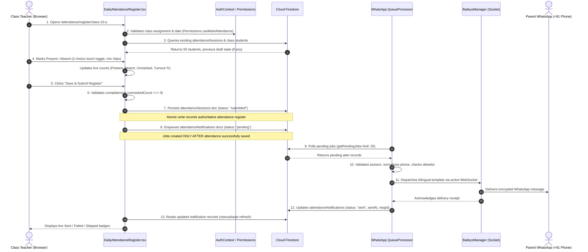

# HanuJai High School ERP — Complete System Design & Architecture

**Campus:** HanuJai High School, Vidyadhar Nagar, Jaipur, Rajasthan, India  
**Affiliation:** Central Board of Secondary Education (CBSE), Affiliation #1730249  
**Pilot Phase:** Phase 1 (Student Roster, Daily Attendance Marking, Parent WhatsApp Notifications)  
**Primary Repository:** `C:\Projects\School\hanujai-erp`  
**Reference Gibbon Repository (Read-Only):** `C:\Projects\School\core`  
**Authoritative Documentation Date:** October 2026  
**Document Status:** Production Architecture Baseline & Verification Audit  

---

## Table of Contents
1. [Section A — System Overview](#section-a--system-overview)
2. [Section B — Exact Repository Structure](#section-b--exact-repository-structure)
3. [Section C — Data Storage Architecture](#section-c--data-storage-architecture)
4. [Section D — Authentication & Authorisation Architecture](#section-d--authentication--authorisation-architecture)
5. [Section E — Attendance Data Flow & Sequence Diagram](#section-e--attendance-data-flow--sequence-diagram)
6. [Section F — WhatsApp & WebSocket Architecture](#section-f--whatsapp--websocket-architecture)
7. [Section G — Deployment Architecture](#section-g--deployment-architecture)
8. [Section H — Environment Variables & Secrets](#section-h--environment-variables--secrets)
9. [Section I — Currently Implemented vs. Recommendations](#section-i--currently-implemented-vs-recommendations)
10. [Section J — Architecture Maintenance Guide](#section-j--architecture-maintenance-guide)

---

## Section A — System Overview

The **HanuJai High School ERP** is a dedicated institutional School Enterprise Resource Planning system engineered specifically for HanuJai High School in Jaipur, Rajasthan. The platform streamlines day-to-day academic operations, starting with Phase 1: authenticated staff access, Class Teacher daily attendance marking, and automated bilingual (English & Hindi) WhatsApp attendance notifications to parents.

### Core Architectural Pillars
1. **React 18 SPA Frontend:** Single Page Application built with TypeScript 5.6 and Vite 5.4. Utilizes client-side routing via `react-router-dom` (v6.28.0) and custom institutional CSS tokens conforming to the approved 11-colour palette.
2. **Dual-Mode Data Abstraction Layer (`DataProvider`):**
   - **Cloud Mode (`VITE_DATA_MODE=firebase`):** Interacts directly with Google Cloud Firestore (`firebase: ^11.0.2`) for persistent multi-user production operations.
   - **Demo / Standalone Mode (`VITE_DATA_MODE=demo`):** Operates on in-browser deterministic fixtures and `localStorage`, enabling full offline evaluation without cloud dependencies.
3. **Dedicated WhatsApp Dispatch Worker (`whatsapp-worker/`):**
   - Independent server-side Node.js daemon executing `@whiskeysockets/baileys` (v7.0.0-rc14).
   - Maintains an authenticated, long-lived outgoing WebSocket directly to WhatsApp Web infrastructure.
   - Decoupled from the frontend by polling an asynchronous outbox queue in Cloud Firestore (`attendanceNotifications`).
4. **Vercel Edge/Serverless Hosting (`vercel.json`):**
   - Delivers static optimized production bundles (`dist/`) globally with aggressive HTTP caching and client-side SPA routing rewrites.

### High-Level System Architecture Diagram (Current Implementation)

```mermaid
graph TB
    subgraph ClientBrowser [Browser Client - Desktop & Mobile]
        TeacherUI[Class Teacher / Principal UI]
        AuthCtx[Auth Context & Role State]
        DataCtx[Data Provider Abstraction]
    end

    subgraph VercelEdge [Vercel Hosting Platform]
        StaticDist[Vite SPA Static Distribution /index.html + assets]
        Rewrites[SPA URL Rewrites to /index.html]
    end

    subgraph FirebaseCloud [Google Firebase & Google Cloud]
        FirebaseAuth[Firebase Authentication]
        Firestore[(Cloud Firestore NoSQL)]
        subgraph FirestoreCollections [Authoritative Collections]
            ColStaff[staff]
            ColStudents[students]
            ColSessions[attendanceSessions]
            ColQueue[attendanceNotifications Outbox]
            ColMarks[marksRegisters]
            ColAudit[auditEvents]
        end
    end

    subgraph PersistentHost [Persistent Worker Host (Local / Cloud VM / Container)]
        WorkerDaemon[Node.js WhatsApp Worker scripts/whatsappWorker.ts]
        BaileysSock[Baileys WASocket Client]
        QueueProc[Queue Processor Interval 5s]
        AuthDisk[Local Auth Filesystem ./.baileys_auth/]
        HttpHealth[Local HTTP Health Port 3001]
    end

    subgraph MetaNetwork [WhatsApp / Meta Infrastructure]
        MetaWS[WhatsApp Web WebSocket wss://web.whatsapp.com]
        ParentPhone[Parent / Guardian WhatsApp]
    end

    %% Interactions
    TeacherUI -->|1. Loads SPA Bundle| StaticDist
    StaticDist --> Rewrites
    TeacherUI -->|2. Authenticates| FirebaseAuth
    TeacherUI -->|3. Queries Students & Sessions| Firestore
    TeacherUI -->|4. Submits Attendance & Enqueues Alerts| ColSessions
    TeacherUI -->|4b. Writes Notification Jobs| ColQueue

    QueueProc -->|5. Polls Pending Jobs (every 5s)| ColQueue
    QueueProc -->|6. Validates Session & Normalizes Phone| Firestore
    QueueProc -->|7. Dispatches Text Alert| BaileysSock
    BaileysSock -->|8. Outgoing Encrypted Socket| MetaWS
    MetaWS -->|9. Delivers Message| ParentPhone

    BaileysSock <-->|Session Creds & Keys| AuthDisk
    QueueProc -->|10. Updates Job Status sent/failed/skipped| ColQueue
    TeacherUI -.->|11. Reads Delivery Status| ColQueue
    WorkerDaemon --- HttpHealth

    classDef implemented fill:#f0fdf4,stroke:#16a34a,stroke-width:2px,color:#14532d;
    classDef cloud fill:#eff6ff,stroke:#2563eb,stroke-width:2px,color:#1e3a8a;
    classDef worker fill:#faf5ff,stroke:#9333ea,stroke-width:2px,color:#581c87;
    class TeacherUI,AuthCtx,DataCtx,StaticDist,Rewrites implemented;
    class FirebaseAuth,Firestore,ColStaff,ColStudents,ColSessions,ColQueue,ColMarks,ColAudit cloud;
    class WorkerDaemon,BaileysSock,QueueProc,AuthDisk,HttpHealth worker;
```

---

## Section B — Exact Repository Structure

The following tree represents the exact, active file and directory layout in `C:\Projects\School\hanujai-erp`. Gibbon core files (`C:\Projects\School\core`) remain strictly untouched and separate.

```
C:\Projects\School\hanujai-erp\
├── .baileys_auth/                     # Local persistent Baileys session keys & credentials (git-ignored)
├── docs/                              # Project documentation and specifications
│   ├── architecture/                  # Dedicated system architecture documentation
│   │   └── HANUJAI_ERP_SYSTEM_ARCHITECTURE.md # This authoritative document
│   ├── DESIGN_INVENTORY.md            # Route-by-route UI specification
│   ├── SCREEN_ROUTE_MAP.md            # Complete application routing & permission inventory
│   └── UI_REVIEW.md                   # Visual audit & design token verification
├── public/                            # Static assets served untouched by Vite
│   ├── assets/                        # Publicly available branding derivatives
│   │   ├── hanujai_logo.jpeg          # Official school crest source image (260x268 px)
│   │   └── hanujai_logo.png           # Lossless PNG derivative of official crest
│   ├── favicon.ico                    # Multiresolution browser tab favicon (32x32 / 64x64)
│   ├── favicon.png                    # Square 260x268 PNG favicon
│   ├── manifest.json                  # PWA Web App Manifest referencing official logo
│   └── whatsapp-qr.html               # Live HTML pairing page rendered by Baileys manager
├── scripts/                           # Top-level orchestration & operational CLI scripts
│   ├── seedFirebase.ts                # Cloud Firestore seed script for deterministic master data
│   ├── whatsappLogout.ts              # Disconnects Baileys session and cleans .baileys_auth/
│   ├── whatsappSendTest.ts            # Controlled single-message test utility with allowlist safety
│   ├── whatsappStatus.ts              # Inspects credentials and queries health of WhatsApp daemon
│   └── whatsappWorker.ts              # Root entry point to launch whatsapp-worker
├── src/                               # Frontend Single-Page Application source code
│   ├── assets/                        # Bundled media & branding assets
│   │   ├── hanujai_logo.jpeg          # Official school crest source image
│   │   └── hanujai_logo.png           # Lossless PNG imported across React components
│   ├── components/                    # Reusable React UI component library
│   │   ├── feedback/                  # ErrorBanner, LoadingState, EmptyState
│   │   ├── layout/                    # AppLayout, Topbar, Sidebar, PageHeader
│   │   ├── tables/                    # DataTable, SortableTable, Pagination
│   │   └── ui/                        # Modal, Drawer, StatusBadge, SegmentedControl
│   ├── config/                        # Runtime feature flags & environment configurations
│   │   ├── firebase.ts                # Firebase client SDK initialization & Firestore instance
│   │   └── phase.ts                   # Phase 1 lock configuration (enforces attendance & WhatsApp focus)
│   ├── context/                       # Global React state providers
│   │   ├── AuthContext.tsx            # Session state, credentials, and role switching
│   │   └── DataContext.tsx            # Provides DataProvider (Firestore vs Demo repository)
│   ├── data/                          # Data layer implementations
│   │   ├── demo/                      # Deterministic fixtures (students, marks, attendance)
│   │   │   ├── historicalGenerator.ts # Generates 1,000 students and 3 years of academic records
│   │   │   └── seedData.ts            # Baseline faculty accounts and school settings
│   │   ├── firebase/                  # Cloud Firestore repository implementation
│   │   │   └── firestoreRepository.ts # Firestore read/write operations, transactions, batching
│   │   ├── demoRepository.ts          # LocalStorage-backed repository for Demo mode
│   │   └── provider.ts                # Abstract DataProvider interface contract
│   ├── domain/                        # Pure business logic & domain rules
│   │   ├── permissions.ts             # Role-Based Access Control (RBAC) permission checks
│   │   ├── policy.ts                  # CBSE attendance rules, local time calculations, grading scales
│   │   └── types.ts                   # TypeScript interfaces (StudentRecord, StaffUser, AttendanceSession)
│   ├── pages/                         # Route page controllers
│   │   ├── academics/                 # MarksEntryRegister, AssessmentList
│   │   ├── admin/                     # StaffDirectory, ClassTeacherAssignments, ClassesDirectory
│   │   ├── attendance/                # DailyAttendanceRegister, AttendanceDashboard, History
│   │   ├── auth/                      # StaffLogin (Authenticated portal login)
│   │   ├── dashboard/                 # PrincipalDashboard, ClassTeacherDashboard, SubjectTeacherDashboard
│   │   ├── error/                     # AccessDenied, NotFound
│   │   ├── reports/                   # StudentReportCard, PTMSlip, ClassAcademicSummary
│   │   └── students/                  # StudentDirectory, StudentDetail
│   ├── services/                      # Client-side domain services
│   │   └── whatsapp/                  # WhatsApp queue client service
│   │       ├── messageTemplates.ts    # Authoritative bilingual notification templates
│   │       ├── types.ts               # WhatsApp notification job and statistics interfaces
│   │       └── whatsappService.ts     # Outbox enqueueing and job query methods
│   ├── styles/                        # Global styling and CSS design system
│   │   └── designSystem.css           # 11-colour palette, responsive layout, touch targets
│   ├── utils/                         # Helper utilities (date formatting, XLSX export, math)
│   ├── App.tsx                        # Root application component with route tree and guards
│   ├── main.tsx                       # Vite DOM mount entry point
│   └── vite-env.d.ts                  # Vite client environment typing
├── whatsapp-worker/                   # Dedicated server-side Baileys WhatsApp worker
│   ├── src/                           # Worker TypeScript source files
│   │   ├── baileysManager.ts          # Baileys socket lifecycle, QR pairing, reconnection loop
│   │   ├── config.ts                  # Worker configuration loader and environment parser
│   │   ├── firebase.ts                # Worker Firestore connection and queue query methods
│   │   ├── httpServer.ts              # Lightweight internal HTTP health check server (port 3001)
│   │   ├── index.ts                   # Main worker startup and graceful shutdown coordinator
│   │   ├── logout.ts                  # Clean session revocation script
│   │   ├── queueProcessor.ts          # Continuous 5s polling queue worker with allowlist safety
│   │   ├── sendTest.ts                # Direct test dispatcher
│   │   └── status.ts                  # CLI status reporter
│   ├── package.json                   # Worker dependencies (@whiskeysockets/baileys, pino, qrcode)
│   └── tsconfig.json                  # Worker TypeScript configuration
├── .env.example                       # Documented environment variable template
├── .env.local                         # Local environment configuration (git-ignored)
├── .gitignore                         # Git exclusion rules (creds, node_modules, dist, .baileys_auth)
├── eslint.config.js                   # ESLint configuration
├── firebase.json                      # Firebase CLI configuration for firestore.rules & indexes
├── firestore.indexes.json             # Composite indexes for attendance, students, and marks
├── firestore.rules                    # Cloud Firestore role-based security rules
├── index.html                         # SPA HTML entry point (Inter font, official favicon, title)
├── package.json                       # Root workspace dependencies and npm scripts
├── storage.rules                      # Firebase Storage security rules
├── tsconfig.json                      # Root TypeScript project configuration
├── vercel.json                        # Vercel deployment configuration (build, output, SPA rewrites)
└── VERCEL_FIREBASE_DEPLOYMENT_GUIDE.md# Firebase migration and deployment reference
```

---

## Section C — Data Storage Architecture

The following matrix documents the authoritative storage mechanism, access rules, security boundaries, and verification status for every data category in the HanuJai ERP ecosystem.

| Data Category | Storage Mechanism | Location / Collection / Env Var | Reader Component | Writer Component | Persistence | Accessibility | Security Boundary | Verification Status |
|---|---|---|---|---|---|---|---|---|
| **Student Profiles & Admission** | Cloud Firestore | `students/{studentId}` | Frontend (`firestoreRepository.ts`), WhatsApp Worker (`queueProcessor.ts`) | Frontend (`enrollStudent`, `updateStudent`), Seed script (`seedFirebase.ts`) | Persistent | Authenticated Staff | Read by Principal & Teachers; write restricted to Principal | Verified from Source & Seed Data |
| **Staff Accounts & Credentials** | Cloud Firestore + Firebase Auth | `staff/{staffId}` & Firebase Auth UID | Frontend (`AuthContext.tsx`), Cloud Rules (`firestore.rules`) | Principal (`StaffAccountModal.tsx`), Seed script (`seedFirebase.ts`) | Persistent | Authenticated Staff | Principal can read/write; staff member can read own record | Verified from Source |
| **Faculty Role Assignments** | Cloud Firestore | `staff/{staffId}.role` & `assignedClasses` | Frontend (`Permissions.ts`, `Sidebar.tsx`, `Topbar.tsx`) | Principal (`ClassTeacherAssignments.tsx`) | Persistent | Authenticated Staff | Evaluated via `request.auth.uid` against `/staff/$(request.auth.uid)` | Verified from Source |
| **Classes & Sections** | Cloud Firestore | `classes/{classId}` | Frontend (`DailyAttendanceRegister.tsx`, `StudentDirectory.tsx`) | Seed script (`seedFirebase.ts`), Principal | Persistent | Authenticated Staff | Read by all authenticated staff; write restricted to Principal | Verified from Source |
| **Curriculum Subjects** | Cloud Firestore | `subjects/{subjectId}` | Frontend (`MarksEntryRegister.tsx`) | Seed script (`seedFirebase.ts`) | Persistent | Authenticated Staff | Read by all staff; modified only by Principal | Verified from Source |
| **Subject Faculty Mappings** | Cloud Firestore | `subjectAssignments/{assignId}` | Frontend (`SubjectTeacherDashboard.tsx`) | Principal (`SubjectFacultyAssignments.tsx`), Seed script | Persistent | Authenticated Staff | Read by all staff; modified by Principal | Verified from Source |
| **Academic Sessions & Dates** | Cloud Firestore | `academicYears/{yearId}` | Frontend (`AcademicYearSettings.tsx`, `DailyAttendanceRegister.tsx`) | Principal, Seed script | Persistent | Authenticated Staff | Read by all staff; modified by Principal | Verified from Source |
| **Assessment Cycles & Weightage** | Cloud Firestore | `assessments/{assessmentId}` | Frontend (`AssessmentList.tsx`) | Principal, Seed script | Persistent | Authenticated Staff | Read by all staff; configured by Principal | Verified from Source |
| **Marks Registers & Scores** | Cloud Firestore | `marksRegisters/{registerId}` | Frontend (`MarksEntryRegister.tsx`, `StudentReportCard.tsx`) | Subject Teacher (`submitMarksRegister`), Principal | Persistent | Authenticated Staff | Subject Teacher can write only for assigned class/subject | Verified from Source |
| **Daily Attendance Sessions** | Cloud Firestore | `attendanceSessions/{sessionId}` | Frontend (`DailyAttendanceRegister.tsx`), WhatsApp Worker (`queueProcessor.ts`) | Class Teacher (`submitAttendanceSession`), Principal | Persistent | Authenticated Staff | Class Teacher can write only for assigned class on current date | Verified from Source |
| **Individual Attendance Entries** | Cloud Firestore | Embedded array `attendanceSessions/{sessionId}.records` | Frontend (`DailyAttendanceRegister.tsx`) | Class Teacher, Principal | Persistent | Authenticated Staff | Strictly present or absent in Phase 1; dual-custody for edits | Verified from Source |
| **Teacher Notes & Incidents** | Cloud Firestore | `incidents/{incidentId}` | Frontend (`BehaviourDirectory.tsx`) | Teaching Faculty, Principal | Persistent | Authenticated Staff | Read/write by authenticated staff | Verified from Source |
| **Pastoral Follow-Up Actions** | Cloud Firestore | `studentFollowUps/{followUpId}` | Frontend (`StudentDetail.tsx`) | Teaching Faculty | Persistent | Authenticated Staff | Append-only; deletion forbidden by `firestore.rules` | Verified from Source |
| **System Security Audit Trail** | Cloud Firestore | `auditEvents/{eventId}` | Frontend (`AuditLogDirectory.tsx`) | Frontend repositories (`logAuditEvent`) | Persistent | Principal Only | Append-only; updates and deletions strictly forbidden by rules | Verified from Source |
| **WhatsApp Notification Queue** | Cloud Firestore | `attendanceNotifications/{jobId}` | WhatsApp Worker (`queueProcessor.ts`), Frontend (`whatsappService.ts`) | Frontend (`enqueueAttendanceBatch`), Worker (`markJobSent`/`Failed`) | Persistent | Staff (read/write), Worker (server-side) | Queue creation gated to authenticated teachers submitting attendance | Verified from Source |
| **WhatsApp Message Delivery Status** | Cloud Firestore | `attendanceNotifications/{jobId}.deliveryStatus` | Frontend (`DailyAttendanceRegister.tsx`), Worker CLI (`whatsappStatus.ts`) | WhatsApp Worker (`markJobSent`, `markJobFailed`, `markJobSkipped`) | Persistent | Authenticated Staff | Worker updates authoritative outcome (`sent`, `failed`, `skipped`) | Verified from Source |
| **Baileys WhatsApp Auth State** | Local Host Filesystem | `whatsapp-worker/.baileys_auth/` (`creds.json`, keys) | WhatsApp Worker (`baileysManager.ts`) | WhatsApp Worker (`useMultiFileAuthState`) | Persistent on Worker Host | **Worker Host Only (Strictly Private)** | Local filesystem permissions; excluded by `.gitignore` | Verified from Source |
| **Firebase Client SDK Config** | Environment Variables (Vite) | `VITE_FIREBASE_API_KEY`, `VITE_FIREBASE_PROJECT_ID`, etc. | Frontend (`src/config/firebase.ts`) | Deployed build bundle / Vercel Environment | Bundled in client JS | **Public Client Configuration** | Safe for public browsers; security enforced via `firestore.rules` | Verified from Source |
| **Privileged Server Credentials** | Environment Variables (Node) | `FIREBASE_ADMIN_*` or local service account | WhatsApp Worker (`whatsapp-worker/src/firebase.ts`) | Server runtime / local `.env.local` | Persistent on Host | **Server-Side Only (Confidential)** | Never exposed in client code or frontend bundles | Verified from Source |
| **Local App Preferences (Demo)** | Browser `localStorage` | Browser key: `hanujai_demo_*` | Frontend (`demoRepository.ts`) | Frontend in Demo mode | Browser-local | Local Browser Only | Stored per-device; wiped on browser cache clear | Verified from Source |
| **Demo Seed Data** | Bundled TypeScript | `src/data/demo/seedData.ts`, `historicalGenerator.ts` | Frontend in Demo mode, Seed script | Static codebase | Static | Public Client Assets | Bundled into client in Demo mode; read-only | Verified from Source |
| **Document & PTM Templates** | React Components | `src/pages/reports/StudentReportCard.tsx`, `PTMSlip.tsx` | Browser Print View | Static codebase | Static | Authenticated Staff | Rendered client-side for physical printing | Verified from Source |
| **School Logo & Static Branding** | Public Assets & Source Assets | `src/assets/hanujai_logo.png`, `public/assets/hanujai_logo.png` | Frontend components (`Topbar`, `Sidebar`, `StaffLogin`, reports) | Build pipeline | Persistent Static Files | Public Static Assets | Hosted on Vercel CDN; immutable cache control | Verified from Source |
| **Vercel Build Artifacts** | Vercel Global Edge CDN | `dist/` | Global Web Browsers | Vite Build (`tsc -b && vite build`) | Ephemeral per Deploy | Public Web | Served over HTTPS with immutable asset hashing | Verified from Source |

---

## Section D — Authentication & Authorisation Architecture

### 1. User Sign-In Flow
- **Authentication Provider:** Google Firebase Authentication (Email & Password provider) combined with Cloud Firestore `/staff/{uid}` user profiles.
- **Client Sign-In Entry Point:** `src/pages/auth/StaffLogin.tsx` invoking `useAuth().login(email, password)`.
- **Session State Management:** Managed in `src/context/AuthContext.tsx` via `onAuthStateChanged(auth, async (firebaseUser) => ...)`.
- **Token Handling:** Firebase automatically manages short-lived JWT ID tokens (1-hour validity) and transparent token refreshes.

### 2. Role Hierarchy & Assignment
HanuJai High School enforces three distinct operational roles defined in `src/domain/types.ts`:

1. **Principal (`principal`):**
   - Institutional oversight across all classes (1 to 10), sections (A & B), subjects, and faculty.
   - Authorised to view and modify system configuration, assign Class Teachers, create/manage staff accounts, and conduct dual-custody attendance overrides.
   - Access to confidential student risk flags, complete institutional reports, and security audit logs (`auditEvents`).
2. **Class Teacher (`class_teacher`):**
   - Assigned to exactly one primary class/section (e.g., `class-10-a`).
   - Sole authority for morning roll call marking in Phase 1 for their designated section.
   - Authorised to review student dossiers, view parent contact details, and trigger attendance WhatsApp notifications upon submission.
   - Cannot mark attendance for unassigned sections or modify marks registers outside assigned subjects.
3. **Subject Teacher (`subject_teacher`):**
   - Assigned to specific subjects across multiple classes (e.g., Class 9-A Mathematics, Class 10-A Mathematics).
   - Authorised to record and submit assessment marks for their assigned subject registers.
   - View-only access to daily attendance aggregates (`attendanceAggregates`); cannot mark daily morning roll call.

### 3. Frontend Role Enforcement
Protected routes are guarded in `src/App.tsx` using `ProtectedRoute` wrappers that evaluate `currentUser.role` against domain permission matrices in `src/domain/permissions.ts`:
- `Permissions.canMarkAttendance(user, classId)`: Returns `true` if user is Principal OR (`role === 'class_teacher'` AND `assignedClassId === classId`).
- `Permissions.canEnterMarks(user, classId, subjectId)`: Checks subject assignment authorization.
- `Permissions.canManageStaff(user)`: Strictly limited to `principal`.

### 4. Cloud Firestore Security Rules Enforcement
Client-side role checks provide user experience guidance; **Cloud Firestore security rules (`firestore.rules`) enforce authoritative data integrity**:
- Security rules look up the requesting user's profile:
  ```javascript
  function getStaffData() {
    return get(/databases/$(database)/documents/staff/$(request.auth.uid)).data;
  }
  function isPrincipal() {
    return isAuthenticated() && getStaffData().role == 'principal';
  }
  function isClassTeacherOf(classId) {
    return isAuthenticated() && (
      getStaffData().role == 'class_teacher' && 
      getStaffData().assignedClassId == classId
    );
  }
  ```
- **Attendance Rule:** An attendance session can only be created or updated if the caller is the authorized Class Teacher for that `classId` or the Principal.
- **Audit Rule:** `auditEvents` allows `create` if authenticated; `update` and `delete` are set to `if false;`.

---

## Section E — Attendance Data Flow & Sequence Diagram

The complete end-to-end Phase 1 daily roll call workflow operates across 11 discrete steps:



### Safety, Idempotency & Failure Controls
- **Pre-Submit Validation:** If any student remains unmarked (`unmarkedCount > 0`), the submission modal warns the teacher and prevents unintended dispatch.
- **Queue Separation:** Notification jobs are never written before the attendance session document is committed to Firestore.
- **Allowlist Guard:** When `WHATSAPP_SEND_ENABLED=false` or dry-run mode is active, the worker logs the preview and marks jobs with diagnostic metadata without sending live messages.
- **Phone Normalization:** Numbers are stripped of formatting and formatted to E.164 (`+919XXXXXXXXX`). Incomplete or missing numbers are immediately marked as `skipped` with reason `'missing_phone'`, preventing queue blockage.
- **Session Verification:** Before dispatching an alert, the worker verifies that the corresponding `attendanceSessions` document exists and has status `'submitted'`.
- **Duplicate Prevention:** Each student notification job has a deterministic ID format `notif-${sessionId}-${studentId}`. Attempting to resubmit the same register uses Firestore transactions/overwrites, preventing duplicate alert creation.

---

## Section F — WhatsApp & WebSocket Architecture

### 1. Actual Baileys Integration
- **Package:** `@whiskeysockets/baileys` (v7.0.0-rc14) installed in `whatsapp-worker/package.json` and root `package.json`.
- **Worker Entry Point:** `whatsapp-worker/src/index.ts` / `scripts/whatsappWorker.ts`.
- **Socket Initialization:** `BaileysManager.initialize()` in `whatsapp-worker/src/baileysManager.ts` executes `makeWASocket({ ... })`.

### 2. Outgoing Socket vs. Client WebSockets
It is essential to distinguish the two architectures:
1. **Client-Facing WebSocket (Not used here):** A server endpoint accepting incoming socket connections from web browsers (e.g. `ws://myapp.com/chat`).
2. **Baileys Outgoing WebSocket Client (Actual Implementation):** A Node.js client process initiating an **outgoing TLS connection** to WhatsApp's Noise-protocol infrastructure (`wss://web.whatsapp.com/ws/chat`). The worker acts as a WhatsApp Web client, authenticating with cryptographic keypairs.

### 3. Credential Storage & QR Pairing
- **Multi-File Auth State:** Handled via Baileys' `useMultiFileAuthState(config.authDir)` targeting `./.baileys_auth/`.
- **Credential Files:**
  - `creds.json`: Primary device identity, registration credentials, and noise keys.
  - `app-state-sync-key-*.json`: Key synchronization data.
  - `session-*.json`, `pre-key-*.json`: Signal protocol pre-keys.
- **QR Code Generation:** When unauthenticated, Baileys emits `connection.update` with a raw QR string. The worker renders:
  1. An ANSI terminal QR code using `qrcode-terminal` for CLI pairing.
  2. An SVG QR code written to `public/whatsapp-qr.html` accessible at `http://localhost:5173/whatsapp-qr.html`.
- **Designated Sender Phone:** Phone number `+91 95094 89381` links via **WhatsApp > Linked Devices > Link a Device**.

### 4. Detailed Vercel Compatibility Assessment

| Evaluation Dimension | Vercel Serverless / Edge Platform | HanuJai Baileys Worker Requirement | Compatibility Verdict |
|---|---|---|---|
| **Execution Model** | Ephemeral, request-driven lambdas (invoked on HTTP request, frozen immediately after response) | Continuous, persistent event loop running `setInterval(..., 5000)` and Baileys socket listeners | **INCOMPATIBLE** |
| **Connection Lifetime** | Standard timeout: 10s (Hobby) to 60s (Pro). Maximum duration 300s (Fluid Compute) | Indefinite persistent connection (hours/days/weeks); keep-alive pings every 30s | **INCOMPATIBLE** |
| **Filesystem Persistence** | Read-only container root; ephemeral `/tmp` directory wiped between cold starts and isolated per lambda | Persistent writable filesystem for `./.baileys_auth/` (`creds.json`, key rotation on `creds.update`) | **INCOMPATIBLE** |
| **WebSocket Type Supported** | Vercel Functions support *incoming* WebSockets upgraded from HTTP GET requests | Baileys establishes an *outgoing* client WebSocket connection to WhatsApp Web servers | **MISMATCH** |
| **Session Stability** | Instances scale up and down dynamically; instances share zero local memory or state | WhatsApp flags rapid reconnects and instance hopping as suspicious, triggering forced logout (`DisconnectReason.loggedOut`) | **INCOMPATIBLE** |
| **Deployment Packaging** | `vercel.json` packages `dist/` from Vite. Excludes `whatsapp-worker/` source files | Standalone Node.js daemon with dependencies (`pino`, `@whiskeysockets/baileys`) | **NOT DEPLOYED TO VERCEL** |

#### Authoritative Verdict
> **VERDICT: Not suitable for reliable continuous operation in the current Vercel deployment; a separate persistent worker is recommended.**

**Reasoning:**  
While current official Vercel documentation confirms native WebSocket support for incoming client connections via Fluid Compute, Vercel Functions cannot host a stateful, long-lived outgoing WhatsApp client daemon. A Baileys client requires:
1. Continuous background memory and CPU to handle WhatsApp keep-alive intervals (`keepAliveIntervalMs: 30000`).
2. Durable, writable local filesystem access to prevent authentication key desynchronization.
3. An unbroken connection to prevent WhatsApp security systems from revoking linked device credentials due to frequent session flapping.

**Recommended Production Topology:**  
The HanuJai ERP architecture is **already decoupled by design**:
- The **React SPA Frontend** deploys to **Vercel** (`dist/`).
- The **WhatsApp Dispatch Worker** runs on a **persistent container / cloud host** (such as Railway, Render, Fly.io, DigitalOcean, or a dedicated school server) running `npm run whatsapp:worker`.
- The two communicate exclusively through Cloud Firestore (`attendanceNotifications` collection).

---

## Section G — Deployment Architecture

```mermaid
graph LR
    subgraph Users [Users]
        StaffBrowser[Staff Web Browser]
        ParentDevice[Parent WhatsApp]
    end

    subgraph VercelCloud [Vercel Global Edge Network]
        VercelCDN[Vercel CDN Edge Caching]
        StaticAssets[Vite Static SPA dist/]
    end

    subgraph GoogleCloud [Firebase Cloud Infrastructure]
        FirebaseAuthService[Firebase Authentication]
        FirestoreService[(Cloud Firestore Database)]
    end

    subgraph PersistentWorkerPlatform [Persistent Worker Host (Railway / Render / VPS)]
        NodeRuntime[Node.js 22+ Runtime]
        WorkerProcess[HanuJai WhatsApp Worker]
        DiskVol[(Persistent Storage Volume .baileys_auth/)]
    end

    subgraph MetaCloud [WhatsApp / Meta Cloud]
        WhatsAppGW[WhatsApp Web Gateways]
    end

    StaffBrowser -->|HTTPS / Port 443| VercelCDN
    VercelCDN --> StaticAssets
    StaffBrowser -->|HTTPS API / Auth| FirebaseAuthService
    StaffBrowser -->|HTTPS API / Firestore SDK| FirestoreService

    WorkerProcess -->|TLS Outgoing Socket wss://| WhatsAppGW
    WhatsAppGW -->|Push Notification| ParentDevice
    WorkerProcess <-->|Persistent Session Keys| DiskVol
    WorkerProcess -->|Polls Queue / Updates Outcomes| FirestoreService

    classDef edge fill:#f0fdf4,stroke:#16a34a,stroke-width:2px;
    classDef cloud fill:#eff6ff,stroke:#2563eb,stroke-width:2px;
    classDef worker fill:#faf5ff,stroke:#9333ea,stroke-width:2px;
    class VercelCDN,StaticAssets edge;
    class FirebaseAuthService,FirestoreService cloud;
    class NodeRuntime,WorkerProcess,DiskVol worker;
```

### Hosting Breakdown
1. **Frontend Hosting (Vercel):**
   - Repository root linked to Vercel project.
   - Build command: `npm run build` (`tsc -b && vite build`).
   - Output directory: `dist`.
   - Custom Domain: e.g. `erp.hanujai.edu.in`.
2. **Database & Auth (Firebase):**
   - Project: Configured via Firebase Console.
   - Rules deployed via: `firebase deploy --only firestore:rules,firestore:indexes`.
3. **WhatsApp Worker Hosting (Separate Persistent Host):**
   - Recommended platform: Railway / Render Background Worker / Fly.io / Ubuntu VPS.
   - Start command: `node --experimental-strip-types scripts/whatsappWorker.ts`.
   - Requires attached persistent disk volume mounted at `/app/.baileys_auth` to preserve credentials across container restarts.

---

## Section H — Environment Variables & Secrets

The system utilizes environment variables segregated into client-safe and server-only categories:

### 1. Vite Frontend Client Configuration (`.env.local` / Vercel Environment)
These variables are prefixed with `VITE_` and are bundled into the client-side JavaScript. They are **public by design**; security is enforced via Firebase Authentication and Cloud Firestore Security Rules.

| Variable Name | Purpose | Scope | Sensitive? |
|---|---|---|---|
| `VITE_DATA_MODE` | Selects data layer (`firebase` for Cloud, `demo` for offline) | Frontend | No |
| `VITE_FIREBASE_API_KEY` | Firebase Web API Key for client authentication | Frontend | No (Public Web Key) |
| `VITE_FIREBASE_AUTH_DOMAIN` | Firebase OAuth redirect domain (e.g. `project.firebaseapp.com`) | Frontend | No |
| `VITE_FIREBASE_PROJECT_ID` | Google Cloud project identifier | Frontend & Worker | No |
| `VITE_FIREBASE_STORAGE_BUCKET`| Google Cloud Storage bucket identifier | Frontend | No |
| `VITE_FIREBASE_MESSAGING_SENDER_ID`| Firebase Cloud Messaging sender ID | Frontend | No |
| `VITE_FIREBASE_APP_ID` | Firebase Web Application ID | Frontend | No |
| `VITE_WHATSAPP_SEND_ENABLED` | UI feature toggle to display Live vs Dry-Run worker status | Frontend | No |

### 2. WhatsApp Worker Configuration (`.env.local` / Worker Host Environment)
These variables govern the server-side Baileys daemon and must **never** be exposed in client code or frontend builds.

| Variable Name | Purpose | Scope | Sensitive? |
|---|---|---|---|
| `WHATSAPP_PROVIDER` | Provider mode: `baileys` (live WhatsApp) or `dry_run` (preview) | Worker Daemon | No |
| `WHATSAPP_SEND_ENABLED` | Master switch for live parent message dispatch (`true` or `false`) | Worker Daemon | Operational Control |
| `WHATSAPP_DRY_RUN` | When `true`, suppresses live dispatch and prints previews | Worker Daemon | No |
| `WHATSAPP_SENDER_PHONE` | Designated school sender mobile number (`9509489381`) | Worker Daemon | Operational Control |
| `WHATSAPP_TEST_ALLOWLIST`| Comma-separated parent phone numbers allowed in testing | Worker Daemon | Sensitive (Parent Data) |
| `WHATSAPP_AUTH_DIR` | Filesystem directory storing Baileys session keys (`./.baileys_auth`) | Worker Daemon | Local Path |
| `WHATSAPP_WORKER_PORT` | Local port for worker HTTP health check (`3001`) | Worker Daemon | Network Port |
| `FIREBASE_CLIENT_EMAIL` | Optional: Service account email for privileged server SDK | Worker Daemon | Confidential Secret |
| `FIREBASE_PRIVATE_KEY` | Optional: Service account private key for privileged access | Worker Daemon | **CRITICAL SECRET** |

---

## Section I — Currently Implemented vs. Recommendations

To maintain complete transparency, system capabilities are divided into verified source implementations and recommended next steps:

### Currently Implemented & Verified from Source
- [x] **Official Logo Branding:** Official HanuJai circular crest (`hanujai_logo.png`, 260x268 px) integrated across Sidebar, Topbar, StaffLogin, StudentReportCard, PTMSlip, favicon, and PWA manifest with natural aspect ratio (`object-fit: contain`).
- [x] **Phase 1 Daily Attendance UI:** Clean Class Teacher workflow with roll number pills, first name on line 1, last name on line 2, accessible touch buttons (min 44px), Present/Absent counters, and turnout calculations.
- [x] **Bilingual Attendance Messages:** Formatted English and Hindi parent alert templates with guardian name substitution (`Mr./Mrs. {Guardian Name}`) and localized date formatting.
- [x] **Firestore Outbox Queue:** `attendanceNotifications` collection schema with `pending`, `processing`, `sent`, `failed`, and `skipped` states.
- [x] **Decoupled Baileys Worker:** Standalone Node.js worker with automatic QR generation, terminal display, web preview (`whatsapp-qr.html`), and exponential backoff reconnection logic.
- [x] **Testing Safety Controls:** Test allowlist filtering (`WHATSAPP_TEST_ALLOWLIST`) ensuring messages only reach authorized phone numbers during verification.
- [x] **Role-Based Security Rules:** Complete Cloud Firestore security rules (`firestore.rules`) enforcing Principal oversight and Class Teacher section boundaries.
- [x] **Vercel Build Configuration:** Verified `vercel.json` configured for Vite SPA routing and cache optimization.

### Recommended / Still Unverified (Roadmap & Production Hardening)
- [ ] **Production Worker Hosting Setup:** Provision a persistent container service (e.g. Railway or Render) with an attached persistent volume for `./.baileys_auth/`.
- [ ] **QR Pairing Execution:** Physical scanning of the pairing QR code using the designated school phone (`9509489381`) to establish the live production session.
- [ ] **Automated Queue Dead-Letter Handling:** Implement an automated retry ceiling (e.g., maximum 3 retries) and dead-letter alerting for permanently invalid phone numbers.
- [ ] **Phase 2 Module Expansion:** Planned future activation of Student Behaviour Dossiers, Periodic Assessment Mark Entry, and CBSE Report Card batch printing.

---

## Section J — Architecture Maintenance Guide

When maintaining or extending the HanuJai ERP codebase, follow these established component boundaries:

1. **Adding a New Student Field:**
   - Update TypeScript interface in `src/domain/types.ts` (`StudentRecord`).
   - Update demo fixture generator in `src/data/demo/historicalGenerator.ts`.
   - Update Firestore repository mapping in `src/data/firebase/firestoreRepository.ts`.
   - Update Student Detail view in `src/pages/students/StudentDetail.tsx`.
2. **Modifying Attendance Logic or Policies:**
   - Update attendance calculations and CBSE turnout rules in `src/domain/policy.ts`.
   - Adjust UI state handlers in `src/pages/attendance/DailyAttendanceRegister.tsx`.
   - If security boundaries change, update matching rules in `firestore.rules`.
3. **Modifying Parent WhatsApp Templates:**
   - Update authoritative templates in `src/services/whatsapp/messageTemplates.ts`.
   - Verify variables match `attendanceState`, `studentName`, `guardianName`, and `date`.
   - If worker requires template logic, update `whatsapp-worker/src/queueProcessor.ts`.
4. **Updating School Branding or Logo:**
   - Place original source image in `src/assets/` and `public/assets/`.
   - Generate PNG and favicon derivatives (`public/favicon.ico`, `public/favicon.png`).
   - Maintain `object-fit: contain` and natural aspect ratio in layout components.
5. **Updating Cloud Firestore Security Rules:**
   - Modify `firestore.rules`.
   - Run verification locally or deploy via `firebase deploy --only firestore:rules`.
   - Always ensure audit logs (`auditEvents`) remain append-only.
