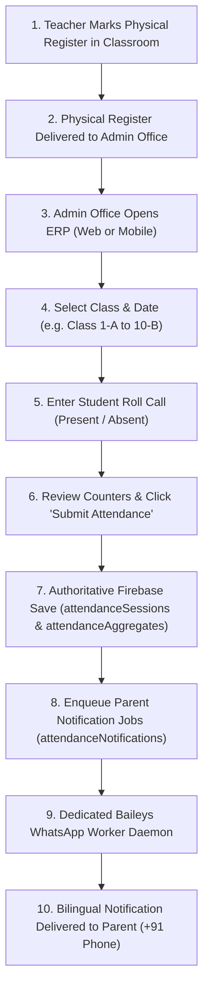

# HanuJai High School ERP — Operating Model Architecture: Centralized Attendance & Student Records

## Executive Summary

Following strategic directives from school leadership (Principal and Director), the HanuJai High School ERP across both Web (`hanujai-erp`) and Mobile (`hanujai-erp-mobile`) operates under a **Centralized Administrative Operating Model**:

1. **Classroom Mobile Phone Policy**: Classroom teachers are strictly prohibited from using mobile phones inside classrooms during instructional hours. Attendance is marked by teachers on official physical attendance registers in classrooms.
2. **Centralized Data Entry via Admin Office**: Physical classroom registers are collected by the school administration every morning and delivered to the **Admin Office**. A designated administrative officer enters the roll call into the ERP.
3. **Two Active User Accounts**:
   - **Principal**: School-wide executive oversight, viewing and reporting. Strictly **READ-ONLY**.
   - **Admin Office**: Central operational account. Access to all students, all configured classes/sections, and authority to mark and submit daily attendance registers.
4. **Automated WhatsApp Attendance Notifications**: Triggered immediately upon successful register submission by the Admin Office for **BOTH Present and Absent** students using the approved bilingual template.
5. **Future Developer / Root Admin Role**: Architectural placeholder reserved for server-side provisioning in a future phase. Uncreated, invisible, and strictly isolated with zero client-side backdoors.

---

## 1. Operating Model & Workflow Diagram



---

## 2. Active Role & Permission Model

| Capability / Resource | Principal (`principal`) | Admin Office (`admin`) | Future Root Admin (`developer`) | Classroom Teachers (Deactivated) |
| :--- | :--- | :--- | :--- | :--- |
| **Active Login Access** | **YES** | **YES** | **PLANNED (Future)** | **NO (Deactivated)** |
| **Scope of View** | Whole School (~1,000 students, 20 sections) | Whole School (~1,000 students, 20 sections) | System-Wide | None |
| **Operational Designation** | Principal & Head of School | Administrative Officer | System Architect | Historical Staff Record Only |
| **View Student Directory & Profiles** | YES (Read-Only) | YES (Full Access) | YES | NO |
| **View Daily Attendance Status** | YES (Read-Only) | YES (Full Access) | YES | NO |
| **Mark Daily Attendance** | **NO (Strictly Forbidden)** | **YES (All Classes)** | YES | **NO** |
| **Submit Attendance Registers** | **NO (Strictly Forbidden)** | **YES (Class-by-Class)** | YES | **NO** |
| **Record Attendance Corrections** | **NO** | **YES (Policy-Gated)** | YES | **NO** |
| **Export CBSE Excel (.xlsx) Reports** | YES | YES | YES | NO |
| **View System Audit Ledger** | YES | YES | YES | NO |
| **Manage Core Infrastructure / Auth** | NO | NO | YES (Future Server CLI) | NO |

---

## 3. Account Provisioning & Deactivation Protocol

### A. Principal Account
- **Canonical Role**: `principal`
- **Email**: `principal@hanujai.edu.in`
- **Employee Code**: `EMP-1998-001`
- **Status**: `active`
- **Permissions**: Read-only oversight across all whole-school dashboards, student profiles, and multi-month historical reports. All attendance submission CTA buttons are omitted.

### B. Admin Office Account
- **Canonical Role**: `admin`
- **User-Facing Title**: **Admin Office**
- **Email**: `admin@hanujai.edu.in` (alias: `admin.office@hanujai.edu.in`)
- **Employee Code**: `EMP-ADMIN-01`
- **Status**: `active`
- **Permissions**: Full operational data entry across every configured class section (Class 1-A through Class 10-B) without requiring teacher assignment constraints.

### C. Safe Deactivation of Classroom & Subject Teachers
- **Status**: `deactivated` (stored in Firestore `/staff/{id}` as `status: 'deactivated'`, `activeRole: 'deactivated'`).
- **Data Preservation**: Historical identities (`name`, `email`, `employeeCode`, `designation`, `department`, `phone`, past attendance session attribution) are **100% preserved**. No records were deleted.
- **Login Denial**: Any login attempt using teacher credentials triggers an explicit security denial:
  `"Classroom teacher accounts are deactivated in this operating phase. Classroom attendance is entered centrally by the Admin Office."`

### D. Future Developer / Root Admin Role Architecture
- **Canonical Role Key**: `developer`
- **Current Status**: **Uncreated and Invisible**.
- **Security Boundaries**:
  - No client-side bypass buttons, secret query parameters, or hidden switcher cards.
  - Role definition in `types.ts` and `Permissions` safely accommodates the role key when server-side credentials are later provisioned.
  - Future activation will occur strictly via trusted server-side CLI or Firebase Admin SDK with mandatory audit logging.

---

## 4. Attendance Data Entry Workflow (Class-by-Class)

1. **Independent Per-Class Isolation**:
   - Each attendance session is keyed deterministically by `att-{classId}-{date}`.
   - Submitting attendance for Class 10-A is saved independently and does **not** overwrite or affect Class 10-B or Class 9-A.
2. **Mandatory Unmarked Validation**:
   - Every student must be marked either **Present** or **Absent**.
   - Submitting with unmarked students is blocked with an alert detailing the exact count of unmarked rows.
3. **UI Roster Hygiene**:
   - Rows display: **Roll Number**, **Student Name** (First Name on line 1, Last Name on line 2 on mobile), and **Present/Absent dual-toggle**.
   - **Admission Numbers** are strictly hidden from daily roll-call UI to prevent visual clutter, but remain preserved in underlying database records.
   - Status options are strictly binary: **Present** and **Absent** (No Late, No Excused).

---

## 5. Automated Bilingual WhatsApp Parent Notifications

Parent notification jobs are automatically generated immediately upon successful register submission by the Admin Office:

### A. Eligibility Rule
- Notifications are enqueued for **BOTH Present and Absent** students.
- Only skipped if the student profile lacks a valid registered phone number (`missing_phone`).

### B. Approved Bilingual Message Template (Preserved 1:1)

```text
Mr./Mrs. {Parent Name},

This is to inform you that {Student Name} has been marked {PRESENT/ABSENT} at HanuJai High School on {Date}.

If you believe this record is incorrect, please contact the school.

Regards,
HanuJai High School

---

श्री/श्रीमती {Parent Name Hindi},

आपको सूचित किया जाता है कि आपकी संतान {Student Name} को दिनांक {Date} को हनुजाई हाई स्कूल में {उपस्थित (PRESENT) / अनुपस्थित (ABSENT)} दर्ज किया गया है।

यदि आपको लगता है कि उपस्थिति का यह रिकॉर्ड गलत है, तो कृपया विद्यालय से संपर्क करें।

सादर,
हनुजाई हाई स्कूल
```

### C. Queue Processing & Idempotency
- **Document Key**: `att_{sessionId}_{studentId}` ensures guaranteed idempotency. Re-submissions or page refreshes update existing jobs rather than generating duplicate messages.
- **Background Daemon**: Processed asynchronously by the Baileys worker daemon, completely decoupling message delivery from the web and mobile UI.

---

## 6. Shared Firebase Backend & Security Rules

Both the Web application (`hanujai-erp`) and Mobile application (`hanujai-erp-mobile`) share the authoritative Firebase environment (`hanujai-erp-demo`):

```firestore
rules_version = '2';
service cloud.firestore {
  match /databases/{database}/documents {
    function isAuthenticated() { return request.auth != null; }
    function getUserData() { return get(/databases/$(database)/documents/staff/$(request.auth.uid)).data; }
    function isPrincipal() { return isAuthenticated() && getUserData().role == 'principal' && getUserData().status == 'active'; }
    function isAdmin() { return isAuthenticated() && (getUserData().role == 'admin' || getUserData().role == 'developer') && getUserData().status == 'active'; }

    // Principal & Admin can inspect student directories and attendance
    match /students/{studentId} {
      allow read: if isAuthenticated() && (isPrincipal() || isAdmin());
      allow create, update: if isAuthenticated() && isAdmin();
      allow delete: if false;
    }

    // Admin Office creates and commits attendance registers; Principal is read-only
    match /attendanceSessions/{sessionId} {
      allow read: if isAuthenticated() && (isPrincipal() || isAdmin());
      allow create, update: if isAuthenticated() && isAdmin();
      allow delete: if false;
    }

    match /attendanceNotifications/{jobId} {
      allow read: if isAuthenticated() && (isPrincipal() || isAdmin());
      allow create, update: if isAuthenticated() && isAdmin();
      allow delete: if false;
    }
  }
}
```
