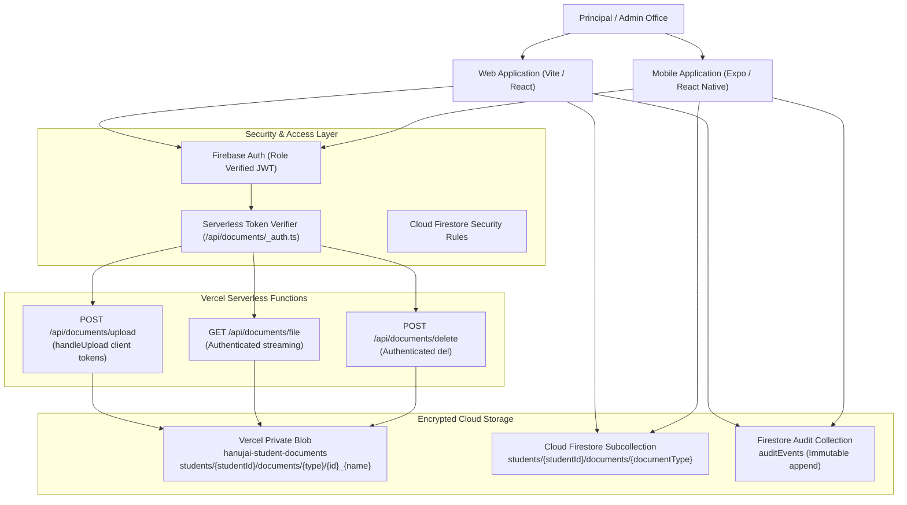

# HanuJai High School ERP — Student Document Management Module & Storage Architecture

## 1. Executive Summary

This document specifies the architecture, data schemas, security rules, and operating procedures for the **Student Document Management Module** of HanuJai High School ERP.

Following institutional directives from the Principal and Director, every enrolled student has a dedicated 9-slot official document repository. This module replaces paper folders in the administration office with a centralized, encrypted, and audit-logged cloud repository accessible across both the Web Application and Mobile Application.

---

## 2. Mandatory 9 Document Slots

Each student profile supports exactly nine standardized document slots categorized into three groups:

| # | Slot Identifier (`documentType`) | Category | Document Name | Required | Max Size | Allowed MIME Types | File Constraints |
|---|---|---|---|---|---|---|---|
| 1 | `student_aadhaar_front` | Student Documents | Student Aadhaar Card (Front) | Yes | 10 MB | `image/jpeg`, `image/png`, `image/webp`, `application/pdf` | PDF or clear color scan |
| 2 | `student_aadhaar_back` | Student Documents | Student Aadhaar Card (Back) | Yes | 10 MB | `image/jpeg`, `image/png`, `image/webp`, `application/pdf` | PDF or clear color scan |
| 3 | `birth_certificate` | Student Documents | Birth Certificate | Yes | 10 MB | `image/jpeg`, `image/png`, `image/webp`, `application/pdf` | Municipal or Registrar scan |
| 4 | `transfer_certificate` | Student Documents | Transfer Certificate (TC) | Yes | 10 MB | `image/jpeg`, `image/png`, `image/webp`, `application/pdf` | Countersigned TC from prior school |
| 5 | `student_photo` | Student Documents | Student Photograph | Yes | 5 MB | `image/jpeg`, `image/png`, `image/webp` | **Image only** (Passport size portrait) |
| 6 | `father_aadhaar_front` | Father's Documents | Father's Aadhaar Card (Front) | Yes | 10 MB | `image/jpeg`, `image/png`, `image/webp`, `application/pdf` | PDF or clear color scan |
| 7 | `father_aadhaar_back` | Father's Documents | Father's Aadhaar Card (Back) | Yes | 10 MB | `image/jpeg`, `image/png`, `image/webp`, `application/pdf` | PDF or clear color scan |
| 8 | `mother_aadhaar_front` | Mother's Documents | Mother's Aadhaar Card (Front) | Yes | 10 MB | `image/jpeg`, `image/png`, `image/webp`, `application/pdf` | PDF or clear color scan |
| 9 | `mother_aadhaar_back` | Mother's Documents | Mother's Aadhaar Card (Back) | Yes | 10 MB | `image/jpeg`, `image/png`, `image/webp`, `application/pdf` | PDF or clear color scan |

---

## 3. Storage Architecture & Separation of Concerns

The module enforces strict separation between **binary media storage** and **document metadata storage**:

1. **Binary Storage (Vercel Private Blob)**:
   - **Store Name:** `hanujai-student-documents` (Owned directly by the school's Vercel account).
   - **Access Level:** Strictly **Private** (HTTP 403 on direct URL access).
   - **Path Pattern**: `students/{studentId}/documents/{documentType}/{timestamp}_{safeName}`
   - Files are stored encrypted at rest with private permissions.
   - Uploads bypass serverless body limits via `@vercel/blob/client`'s `upload()` and `handleUpload`.
   - Streaming is mediated exclusively through authenticated serverless endpoint `/api/documents/file`.

2. **Serverless Functions Layer (`/api/documents/*`)**:
   - `POST /api/documents/upload`: Validates Firebase Auth token and Admin role, verifies file size/type constraints, and issues short-lived client tokens for direct streaming to Vercel Private Blob.
   - `GET /api/documents/file`: Authenticates staff (Principal & Admin Office authorized), streams private blobs with anti-sniffing, private cache control, and content disposition.
   - `POST /api/documents/delete`: Authenticates Admin Office role and deletes private blobs via `del()`.

3. **Metadata Storage (Cloud Firestore)**:
   - **Subcollection Path**: `students/{studentId}/documents/{documentType}`
   - Document ID matches the slot identifier (`documentType`), ensuring O(1) slot resolution and preventing duplicate documents in the same slot.
   - Stores version number, original file name, MIME type, file size, upload timestamp, uploaded by staff ID and name, and storage pathname.

### System Architecture Diagram


        AuditLog["Audit Ledger\nauditEvents/{eventId}"]
    end

    User -->|Browser UI| WebClient
    User -->|Mobile App| MobileClient

    WebClient --> FirebaseAuth
    MobileClient --> FirebaseAuth

    FirebaseAuth --> StorageRules
    FirebaseAuth --> FirestoreRules

    StorageRules -->|Upload / Download / Delete| CloudStorage
    FirestoreRules -->|Read / Write Metadata| Firestore
    FirestoreRules -->|Append Audit Trail| AuditLog
```

---

## 4. Metadata Schema Specification

Each document in `students/{studentId}/documents/{documentType}` adheres to the following TypeScript interface:

```typescript
export interface StudentDocumentRecord {
  id: string; // matches documentType, e.g. "student_aadhaar_front"
  documentType: StudentDocumentType; // One of the 9 defined slot keys
  studentId: string; // Student ID, e.g. "STU-2025-0010"
  storagePath: string; // "students/{studentId}/documents/{documentType}/{fileId}"
  originalFileName: string; // e.g. "Aadhaar_Front_Aarav.pdf"
  contentType: string; // e.g. "application/pdf" or "image/jpeg"
  fileSize: number; // File size in bytes
  uploadedAt: string; // ISO 8601 UTC timestamp
  uploadedBy: string; // Staff ID, e.g. "staff-admin"
  uploadedByName: string; // Staff Name, e.g. "Admin Office"
  updatedAt: string; // ISO 8601 UTC timestamp
  updatedBy: string; // Staff ID
  updatedByName?: string; // Staff Name
  version: number; // Incremented on replacement (1, 2, ...)
  isPresent: boolean; // true if active
  downloadUrl?: string; // Ephemeral download/preview URL
}
```

---

## 5. Role-Based Permissions Matrix

Access to student identity documents is strictly controlled:

| Action | Principal | Admin Office | Class Teacher (Deactivated) | Public / Student |
|---|---|---|---|---|
| View Document Completeness KPI | Yes | Yes | Denied | Denied |
| View Document List & Metadata | Yes | Yes | Denied | Denied |
| Preview Document (Image / PDF) | Yes | Yes | Denied | Denied |
| Download Document Scan | Yes | Yes | Denied | Denied |
| Upload New Document | **Denied (Read-Only)** | **Yes** | Denied | Denied |
| Replace Existing Document | **Denied (Read-Only)** | **Yes** | Denied | Denied |
| Delete Document Scan | **Denied (Read-Only)** | **Yes (With confirmation)** | Denied | Denied |

---

## 6. Security Rules

### Firebase Cloud Storage Rules (`storage.rules`)

```rules
rules_version = '2';
service firebase.storage {
  match /b/{bucket}/o {
    match /{allPaths=**} {
      allow read, write: if false;
    }

    function isAuthenticated() {
      return request.auth != null;
    }

    function getUserData() {
      return firestore.get(/databases/(default)/documents/staff/$(request.auth.uid)).data;
    }

    function isPrincipal() {
      return isAuthenticated() && getUserData().role == 'principal';
    }

    function isAdmin() {
      return isAuthenticated() && (getUserData().role == 'admin' || getUserData().role == 'developer');
    }

    function isValidDocumentType(documentType) {
      return documentType in [
        'student_aadhaar_front',
        'student_aadhaar_back',
        'birth_certificate',
        'transfer_certificate',
        'student_photo',
        'father_aadhaar_front',
        'father_aadhaar_back',
        'mother_aadhaar_front',
        'mother_aadhaar_back'
      ];
    }

    match /students/{studentId}/documents/{documentType}/{fileId} {
      allow read: if isPrincipal() || isAdmin();

      // Student photograph: Image only, max 5MB
      // Other documents: Image or PDF, max 10MB
      allow create, update: if isAdmin() &&
        isValidDocumentType(documentType) &&
        (
          (documentType == 'student_photo' &&
            request.resource.size <= 5 * 1024 * 1024 &&
            request.resource.contentType.matches('image/(jpeg|png|webp)')) ||
          (documentType != 'student_photo' &&
            request.resource.size <= 10 * 1024 * 1024 &&
            request.resource.contentType.matches('image/(jpeg|png|webp)|application/pdf'))
        );

      allow delete: if isAdmin() && isValidDocumentType(documentType);
    }
  }
}
```

### Cloud Firestore Rules (`firestore.rules`)

```rules
    match /students/{studentId} {
      allow read: if isAuthenticated() && (isPrincipal() || isAdmin());
      allow create, update: if isAuthenticated() && isAdmin();
      allow delete: if false;

      // Student Document Metadata (9 Required Slots)
      match /documents/{documentType} {
        allow read: if isAuthenticated() && (isPrincipal() || isAdmin());
        allow create, update, delete: if isAuthenticated() && isAdmin();
      }
    }
```

---

## 7. Privacy & Statutory Safeguards for Aadhaar Scans

In compliance with Indian data protection norms (including UIDAI circulars on Aadhaar usage):
1. **No Plaintext Aadhaar Storage**: Full 12-digit Aadhaar numbers are never parsed, OCR'd, indexed, or stored in plaintext in any database table or search index.
2. **Access Logging**: Every document upload, replacement, and deletion is recorded in the immutable `auditEvents` collection with the actor ID, actor role, timestamp, and client IP address.
3. **No External Transmission**: Student and guardian identity scans are never attached to or transmitted via WhatsApp parent notifications. WhatsApp notifications contain only official attendance confirmation text.
4. **Bucket Privacy**: The Firebase Storage bucket has public access completely blocked. All file accesses require either a Firebase Auth token or a time-limited signed URL.

---

## 8. Firebase Console Setup Guide for Cloud Storage

The Firebase Project ID is **`hanujai-erp-demo`**. Cloud Storage can be provisioned in the Firebase Console following these steps:

### Step 1: Upgrade to Blaze Plan (Pay as you go)
1. Open the [Firebase Console](https://console.firebase.google.com/project/hanujai-erp-demo/overview).
2. In the bottom-left corner, click **Upgrade** from the Spark (no-cost) tier to the **Blaze (Pay as you go)** plan.
   > **Note on Costs**: Cloud Storage includes a generous free allowance every month (5 GB stored data, 1 GB/day download bandwidth, 20,000 upload operations/day, 50,000 download operations/day). For HanuJai High School's student records, standard usage will remain within or close to the free allowance.
3. Attach a Google Cloud billing account.

### Step 2: Provision Cloud Storage Bucket
1. In the left navigation menu, navigate to **Build** → **Storage**.
2. Click **Get Started**.
3. Choose **Start in production mode** (security rules will be deployed from the repository).
4. Select the Cloud Storage location:
   - **Recommended Region**: `asia-south1` (Mumbai, India) for data residency and lowest latency to Jaipur.
5. Click **Done** to create the bucket.

### Step 3: Configure Cloud Storage CORS for Deployed Web Origin
Google Cloud Storage buckets require an explicit CORS policy to allow browser uploads from the deployed Vercel domain (`https://hanujai-erp.vercel.app`).

1. A `cors.json` file is present in the repository root:
```json
[
  {
    "origin": [
      "https://hanujai-erp.vercel.app",
      "http://localhost:5173",
      "http://localhost:4173",
      "http://localhost:3000"
    ],
    "method": ["GET", "POST", "PUT", "DELETE", "HEAD", "OPTIONS"],
    "responseHeader": [
      "Content-Type",
      "Access-Control-Allow-Origin",
      "Authorization",
      "X-Requested-With",
      "x-goog-resumable",
      "x-firebase-storage-version"
    ],
    "maxAgeSeconds": 3600
  }
]
```

2. In Google Cloud Shell or using the Google Cloud SDK:
```bash
# Using Google Cloud CLI:
gcloud storage buckets update gs://hanujai-erp-demo.firebasestorage.app --cors-file=cors.json

# OR using gsutil:
gsutil cors set cors.json gs://hanujai-erp-demo.firebasestorage.app
```

---

## 9. Diagnostic Root Cause of Browser CORS Errors on Deployed Vercel

When an upload fails on `https://hanujai-erp.vercel.app` with `Status: CORS error` and `Transferred: 0.0 kB`:

### Anatomy of the Failure
1. **Endpoint Called**: `https://firebasestorage.googleapis.com/v0/b/hanujai-erp-demo.firebasestorage.app/o?name=...`
2. **Preflight Request**: The browser automatically issues an `OPTIONS` preflight request because cross-origin headers (`Authorization`, `x-goog-upload-protocol`) and file binaries are attached.
3. **Server Response**: Because the default storage bucket has not yet been provisioned in the Firebase Console under the Blaze plan, the Google UploadServer responds with `HTTP 404 Not Found` (`The specified bucket does not exist`).
4. **Browser Enforcement**: In compliance with the W3C CORS specification, any non-2xx status code on an `OPTIONS` preflight causes the browser to abort the request before transferring any file payload (`0.0 kB`). The browser logs `CORS error` in DevTools.
5. **Resolution**:
   - Provision the bucket in Firebase Console (Steps 1 & 2 above).
   - Apply `cors.json` to the provisioned bucket (Step 3 above).
   - The application handles preflight/unreachable errors gracefully, reporting the precise bucket status to the Admin Office rather than an ambiguous generic error.

---

## 10. Safe Testing Procedure

1. **Test Entity**: Use a non-production test student record (e.g. `STU-01A-35` or a dedicated test admission).
2. **Test Payload**: Use a synthetic disposable 1-page sample PDF (e.g. `< 50 KB` sample document text) or non-sensitive sample image.
3. **Zero Aadhaar Exposure**: Real Aadhaar cards, government photo IDs, or genuine child identity scans must never be uploaded during diagnostic checks.


